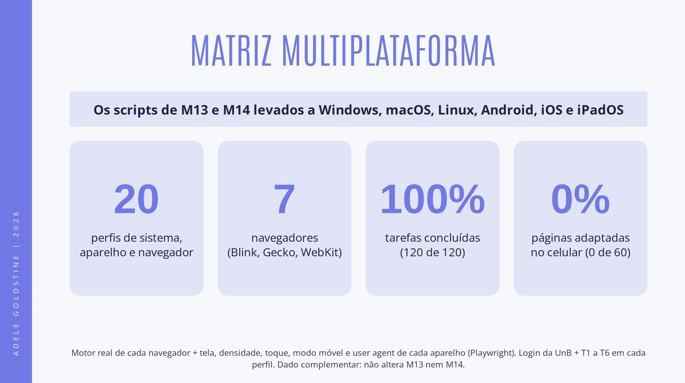
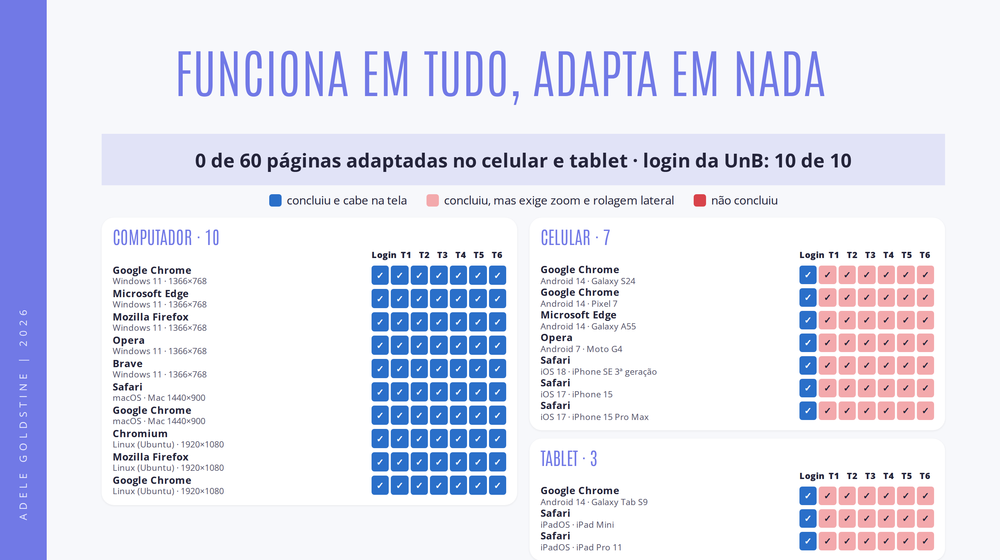
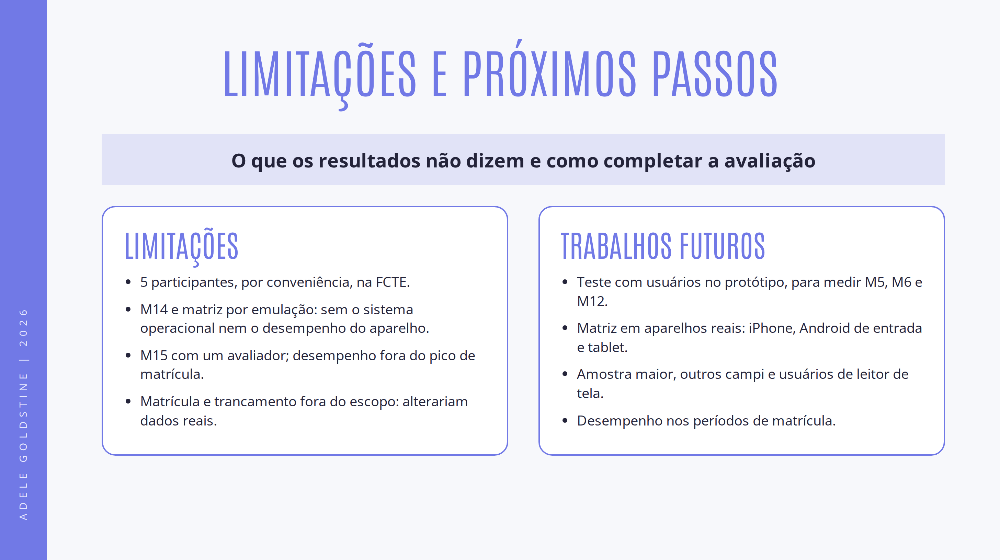
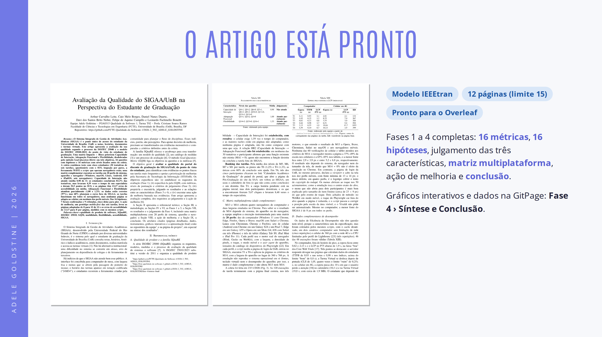

# Apresentação Final

Slides complementares da apresentação final da avaliação do SIGAA/UnB, em imagens PNG de 1456 × 816 px (prontas para importar no Canva) e em PDF: o resultado das 16 métricas com a hipótese de cada uma, a síntese das hipóteses, o julgamento, o ranking das tarefas, a matriz multiplataforma, os dados complementares de desempenho, a conclusão, as melhorias recomendadas e o artigo. Cada imagem pode ser aberta em tamanho real clicando nela. Os slides seguem a identidade visual do *deck* da equipe e são gerados por [`apresentacao/gerar_slides.py`](https://github.com/FCTE-Qualidade-de-Software-1/2026-2_T02_ADELE_GOLDSTINE/blob/main/apresentacao/gerar_slides.py) a partir dos mesmos dados e gráficos da GitPage, de modo que um número no slide é sempre o número da página.

[:material-file-pdf-box: Baixar os slides complementares (PDF)](assets/apresentacao/slides-complementares.pdf){ .md-button .md-button--primary }

As versões interativas dos gráficos, com os valores ao passar o mouse e as tabelas de dados, estão em [Síntese e Conclusão](fase-4/sintese-final.md) e em [Matriz Multiplataforma](fase-4/matriz-multiplataforma.md).

<figure markdown>

<figcaption>1. Adequação Funcional (M1 a M3)</figcaption>
</figure>

<figure markdown>

<figcaption>2. Interação: as tarefas (M4 a M8, M20)</figcaption>
</figure>

<figure markdown>

<figcaption>3. Interação: acesso e satisfação (M9 a M12)</figcaption>
</figure>

<figure markdown>

<figcaption>4. Flexibilidade (M13 a M15)</figcaption>
</figure>

<figure markdown>

<figcaption>5. Hipóteses da Fase 2</figcaption>
</figure>

<figure markdown>

<figcaption>6. Julgamento</figcaption>
</figure>

<figure markdown>

<figcaption>7. Onde corrigir primeiro (ranking das tarefas)</figcaption>
</figure>

<figure markdown>

<figcaption>8. Matriz multiplataforma em números</figcaption>
</figure>

<figure markdown>

<figcaption>9. Funciona em tudo, adapta em nada</figcaption>
</figure>

<figure markdown>

<figcaption>10. No celular, o texto encolhe</figcaption>
</figure>

<figure markdown>

<figcaption>11. Desempenho (complementar)</figcaption>
</figure>

<figure markdown>

<figcaption>12. Conclusão</figcaption>
</figure>

<figure markdown>

<figcaption>13. Melhorias recomendadas</figcaption>
</figure>

<figure markdown>

<figcaption>14. Limitações e próximos passos</figcaption>
</figure>

<figure markdown>

<figcaption>15. O artigo está pronto</figcaption>
</figure>

## Histórico de Versão

| Versão | Data | Descrição | Autor |
| :----: | :--: | :-------: | :---: |
| 1.0 | 23/11/2026 | Criação da página com os slides complementares da apresentação final e o PDF | [arthurlleite](https://github.com/arthurlleite) |
