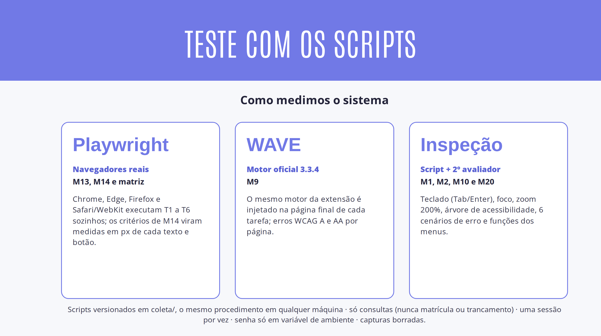
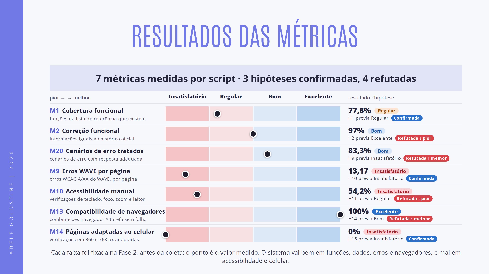
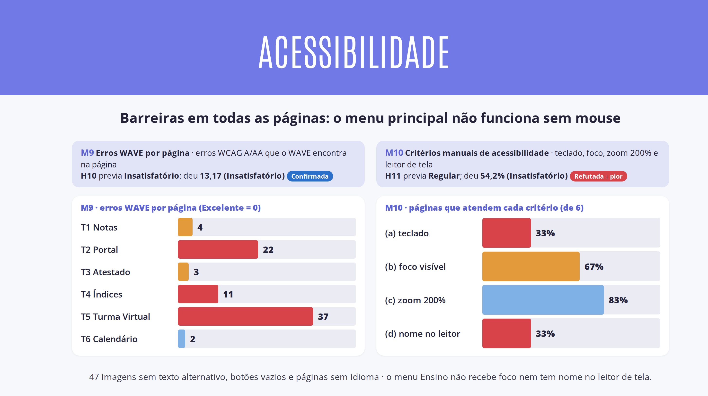
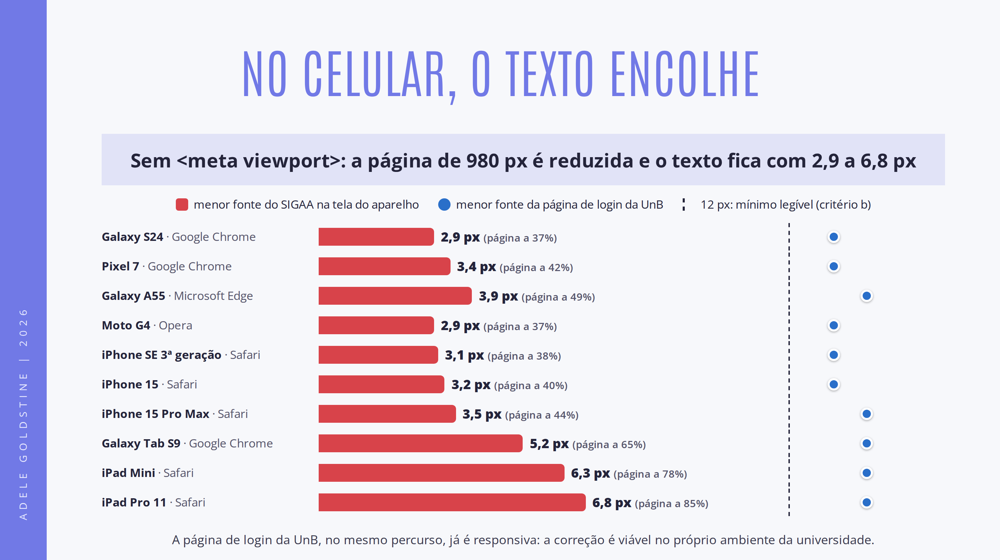
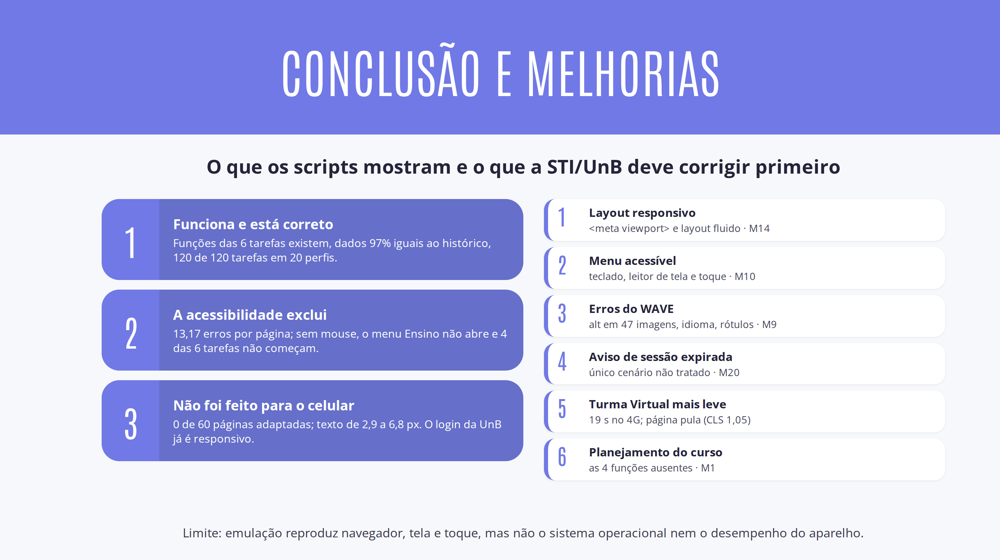

# Apresentação Final

Slides complementares da apresentação final da avaliação do SIGAA/UnB, em imagens PNG de 1456 × 816 px (prontas para importar no Canva) e em PDF: a parte da avaliação medida por *scripts* (inspeção automatizada, WAVE e Playwright): as métricas M1, M2, M20, M9, M10, M13 e M14 com a hipótese de cada uma, a matriz multiplataforma, a conclusão, as melhorias recomendadas e o artigo. Cada imagem pode ser aberta em tamanho real clicando nela, e cada gráfico também está separado, com fundo transparente, em [`docs/assets/apresentacao/pecas/`](https://github.com/FCTE-Qualidade-de-Software-1/2026-2_T02_ADELE_GOLDSTINE/tree/main/docs/assets/apresentacao/pecas). Os slides seguem a identidade visual do *deck* da equipe e são gerados por [`apresentacao/gerar_slides.py`](https://github.com/FCTE-Qualidade-de-Software-1/2026-2_T02_ADELE_GOLDSTINE/blob/main/apresentacao/gerar_slides.py) a partir dos mesmos dados e gráficos da GitPage, de modo que um número no slide é sempre o número da página.

[:material-file-pdf-box: Baixar os slides complementares (PDF)](assets/apresentacao/slides-complementares.pdf){ .md-button .md-button--primary }

As versões interativas dos gráficos, com os valores ao passar o mouse e as tabelas de dados, estão em [Síntese e Conclusão](fase-4/sintese-final.md) e em [Matriz Multiplataforma](fase-4/matriz-multiplataforma.md).

<figure markdown>

<figcaption>1. Teste com os Scripts: como medimos o sistema</figcaption>
</figure>

<figure markdown>

<figcaption>2. Resultados das métricas e hipóteses</figcaption>
</figure>

<figure markdown>

<figcaption>3. Acessibilidade (M9 e M10)</figcaption>
</figure>

<figure markdown>

<figcaption>4. Flexibilidade e matriz multiplataforma (M13 e M14)</figcaption>
</figure>

<figure markdown>

<figcaption>5. No celular, o texto encolhe</figcaption>
</figure>

<figure markdown>

<figcaption>6. Conclusão e melhorias</figcaption>
</figure>

<figure markdown>

<figcaption>7. O artigo está pronto</figcaption>
</figure>

## Histórico de Versão

| Versão | Data | Descrição | Autor |
| :----: | :--: | :-------: | :---: |
| 1.0 | 23/11/2026 | Criação da página com os slides complementares da apresentação final e o PDF | [arthurlleite](https://github.com/arthurlleite) |
