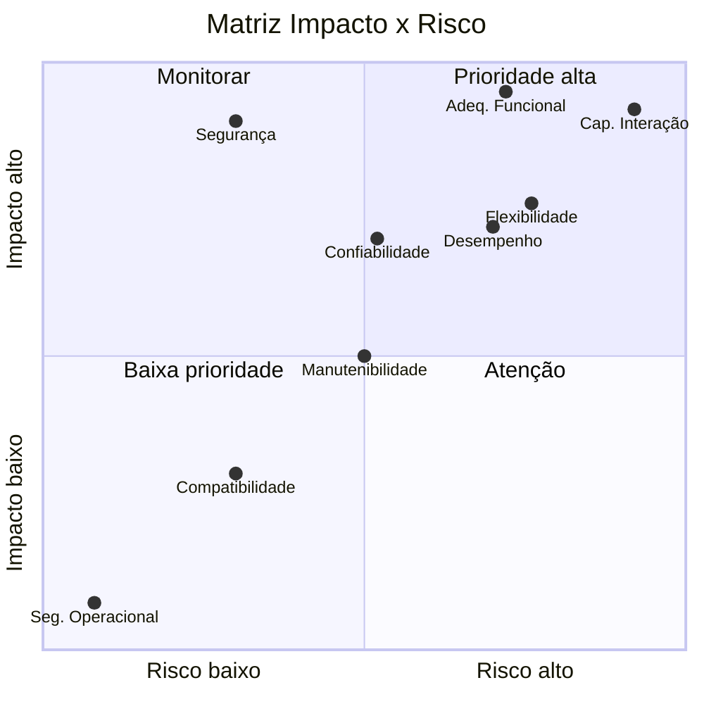

# Características Priorizadas

<!-- Critério 5. Escolher 3 a 4 características. Nível máximo: priorização robusta, com método explícito (ex.: matriz impacto x risco) e trade-offs discutidos. -->

## 1. Método de priorização

A seleção usa uma **matriz Impacto x Risco** com um **filtro de viabilidade de medição**. Cada uma das nove características da ISO/IEC 25010:2023 recebe notas de 1 a 5 em dois eixos, e a prioridade é o produto das notas.

**Impacto (I):** consequência de uma deficiência na característica para as partes interessadas definidas em [Propósito e Partes Interessadas](proposito-stakeholders.md#23-partes-interessadas).

| Nota | Significado |
| :---: | :--- |
| 1 | Irrelevante: nenhuma parte interessada percebe a deficiência |
| 2 | Baixo: incômodo ocasional, sem prejuízo à tarefa |
| 3 | Moderado: atrasa tarefas ou exige ajuda de terceiros |
| 4 | Alto: impede tarefas para um perfil de usuário ou gera retrabalho frequente |
| 5 | Crítico: compromete decisões ou prazos acadêmicos (ex.: perda de prazo, erro de planejamento) para a maioria dos estudantes |

**Risco (R):** probabilidade de a característica apresentar deficiências na versão avaliada, estimada a partir das observações preliminares (OP-01 a OP-08, em [Software Avaliado](software-avaliado.md#4-observacoes-preliminares-da-interface)), da idade da tecnologia e de relatos recorrentes dos estudantes.

| Nota | Significado |
| :---: | :--- |
| 1 | Desprezível: não há indício de problema |
| 2 | Baixo: indícios isolados |
| 3 | Moderado: indícios recorrentes, mas não confirmados na inspeção |
| 4 | Alto: indícios confirmados na inspeção inicial |
| 5 | Muito alto: problemas evidentes, recorrentes e reconhecidos pelos usuários |

**Prioridade (P) = I x R**, variando de 1 a 25.

**Filtro de viabilidade (V):** a característica só pode ser selecionada se puder ser medida de forma válida em avaliação caixa-preta, sem testes intrusivos (ver [Software Avaliado](software-avaliado.md#5-implicacoes-para-a-avaliacao)).

**Regra de corte:** selecionar as características viáveis com P >= 15, limitado a quatro, conforme exigência do roteiro (três a quatro características).

Procedimento de pontuação: cada membro atribui suas notas individualmente; as notas são consolidadas em reunião, e divergências maiores que um ponto são discutidas até o consenso, com registro em ata. A Tabela 1 apresenta a proposta consolidada pelos responsáveis pela Fase 1.

## 2. Avaliação das candidatas

*Tabela 1 - Matriz Impacto x Risco das características da ISO/IEC 25010:2023.*

| Característica | I | R | P = I x R | V | Selecionada |
| :--- | :---: | :---: | :---: | :---: | :---: |
| Capacidade de Interação (Usabilidade) | 5 | 5 | **25** | Sim | **Sim** |
| Adequação Funcional | 5 | 4 | **20** | Sim | **Sim** |
| Eficiência de Desempenho | 4 | 4 | **16** | Sim (parcial) | **Sim** |
| Flexibilidade (Portabilidade) | 4 | 4 | **16** | Sim (parcial) | **Sim** |
| Confiabilidade | 4 | 3 | 12 | Parcial | Não |
| Segurança | 5 | 2 | 10 | Não | Não |
| Manutenibilidade | 3 | 3 | 9 | Não | Não |
| Compatibilidade | 2 | 2 | 4 | Parcial | Não |
| Segurança Operacional | 1 | 1 | 1 | - | Não |

*Fonte: elaboração da equipe.*

*Figura 1 - Posicionamento das características na matriz Impacto x Risco (eixos normalizados de 1 a 5). Fonte: elaboração da equipe.*

### 2.1 Justificativa das notas

*Tabela 2 - Justificativa das notas atribuídas.*

| Característica | Justificativa do Impacto | Justificativa do Risco |
| :--- | :--- | :--- |
| Capacidade de Interação | I = 5: afeta todos os perfis em todas as tarefas; para calouros e estudantes com deficiência, pode impedir a conclusão de tarefas obrigatórias. | R = 5: seis das oito observações preliminares (OP-01 a OP-06) apontam problemas de interação; na experiência dos membros da equipe, é a queixa mais frequente entre os colegas. |
| Adequação Funcional | I = 5: dado errado ou função ausente compromete decisões acadêmicas (matrícula, formatura) sem alternativa oficial. | R = 4: a existência de ferramentas comunitárias para planejar o fluxo (OP-07) indica lacunas de completude; não há indício forte de problemas de correção. |
| Eficiência de Desempenho | I = 4: lentidão atrasa todas as tarefas e é agravada em redes móveis, usadas pelos estudantes de menor renda. | R = 4: a interface JSF gera páginas com muitos elementos e requisições; os membros da equipe relatam lentidão em horários de pico. |
| Flexibilidade | I = 4: estudantes que acessam apenas pelo celular podem ficar impedidos de concluir tarefas. | R = 4: layout de largura fixa e menus acionados pelo ponteiro (OP-02, OP-03) foram confirmados na inspeção. |
| Confiabilidade | I = 4: indisponibilidade no período de matrícula tem impacto alto. | R = 3: relatos concentram-se em picos sazonais, fora da janela de coleta. |
| Segurança | I = 5: vazamento de dados pessoais teria impacto crítico. | R = 2: não há indício público de incidente; autenticação centralizada e expiração de sessão estão presentes. |
| Manutenibilidade | I = 3: afeta a STI, indiretamente o estudante. | R = 3: tecnologia antiga sugere custo de evolução elevado, mas sem evidência direta. |
| Compatibilidade | I = 2: o estudante não percebe a integração entre sistemas SIG. | R = 2: a autenticação integrada funciona de forma transparente. |
| Segurança Operacional | I = 1: o sistema não controla processos físicos. | R = 1: não se aplica. |

*Fonte: elaboração da equipe.*

## 3. Características selecionadas

*Tabela 3 - Características selecionadas, em ordem de prioridade.*

| Prioridade | Característica | Norma | Foco no SIGAA | Partes interessadas atendidas |
| :---: | :--- | :--- | :--- | :--- |
| 1 | Capacidade de Interação (Usabilidade) | ISO/IEC 25010:2023 | O estudante encontra, entende e conclui as tarefas de rotina sem ajuda | Estudantes, DEG/coordenações, STI |
| 2 | Adequação Funcional | ISO/IEC 25010:2023 | As funções necessárias existem, produzem resultados corretos e são adequadas à tarefa | Estudantes, docentes, STI |
| 3 | Eficiência de Desempenho | ISO/IEC 25010:2023 | As páginas das tarefas de rotina respondem em tempo aceitável, inclusive em rede móvel | Estudantes, STI |
| 4 | Flexibilidade (Portabilidade) | ISO/IEC 25010:2023 | As tarefas podem ser concluídas em diferentes navegadores, tamanhos de tela e por toque | Estudantes (sobretudo os que usam só celular), STI |

*Fonte: elaboração da equipe.*

Eficiência de Desempenho e Flexibilidade empataram (P = 16). Ambas foram mantidas porque juntas completam o limite de quatro características e atendem a perfis distintos: a primeira mede o custo de cada interação e a segunda, a possibilidade de interagir em diferentes ambientes.

## 4. Trade-offs e características não selecionadas

- **Confiabilidade (P = 12)** foi a característica mais próxima do corte. Ela foi preterida porque as falhas relevantes concentram-se no período de matrícula, fora da janela de coleta, e sua medição válida exigiria monitoramento contínuo de disponibilidade. Para não perder a informação, falhas observadas durante as tarefas serão registradas como não conformidades de Adequação Funcional, e tempos de resposta anormais aparecerão na Eficiência de Desempenho.
- **Segurança (P = 10)** tem o maior impacto potencial, mas não é avaliável de forma ética sem autorização da STI. Selecioná-la produziria resultados superficiais (apenas verificações de superfície) e desviaria esforço das características com mais indícios.
- **Manutenibilidade** é relevante para a STI, mas depende de acesso ao código-fonte, inexistente nesta avaliação.
- **Compatibilidade** e **Segurança Operacional** têm baixa prioridade no contexto do estudante.

O principal custo desta seleção é que a avaliação **não permitirá concluir sobre a robustez interna do sistema**. Os resultados descrevem a qualidade **em uso pelo estudante**, e não a qualidade técnica da implementação. Esse limite está registrado em [Escopo e Rigor](escopo.md#5-limites-de-validade-dos-resultados).

## 5. Relações esperadas entre as características

O roteiro pede que, ao final do projeto, as relações entre as características sejam discutidas com base nos resultados. As hipóteses de relação abaixo serão confirmadas ou refutadas na Fase 4:

*Tabela 4 - Relações esperadas entre as características selecionadas.*

| Relação | Hipótese | Evidência que permitirá verificar |
| :--- | :--- | :--- |
| Flexibilidade -> Capacidade de Interação | A falta de adaptação a telas pequenas aumenta erros e tempo de tarefa no celular | Comparação das mesmas tarefas em desktop e celular |
| Eficiência de Desempenho -> Capacidade de Interação | Páginas lentas reduzem a eficiência percebida das tarefas | Correlação entre tempo de carregamento e tempo total da tarefa |
| Capacidade de Interação -> Adequação Funcional | Funções existentes, mas difíceis de localizar, são percebidas como ausentes | Casos em que o participante declara que a função "não existe" quando ela existe |
| Eficiência de Desempenho -> Flexibilidade | O peso das páginas penaliza mais o acesso em rede móvel | Comparação de tempos com e sem limitação de rede |

*Fonte: elaboração da equipe.*

## Histórico de Versão

| Versão | Data | Descrição | Autor |
| :----: | :--: | :-------: | :---: |
| 1.0 | 16/10/2026 | Criação do documento: método Impacto x Risco com filtro de viabilidade, matriz, justificativas, seleção, trade-offs e relações esperadas | Caio Borges |
