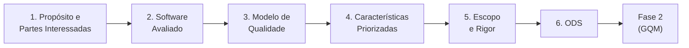

# Fase 1 - Estabelecimento dos Requisitos da Avaliação

<!-- Critério 8. Nível máximo: sumário funcionando, hierarquia consistente, storytelling claro, referências cruzadas completas. -->

## 1. Visão geral

Esta fase corresponde à primeira atividade do processo de avaliação de produto definido pela norma **ISO/IEC 25040** (família SQuaRE): **estabelecer os requisitos da avaliação**. Nela são definidos o propósito da avaliação, quem a demanda e quem usará seus resultados, qual produto será avaliado, qual modelo de qualidade servirá de referência, quais características serão priorizadas e qual o escopo e o rigor do trabalho.

O produto avaliado é o **SIGAA** (Sistema Integrado de Gestão de Atividades Acadêmicas) na instância da **Universidade de Brasília (UnB)**, sob o ponto de vista do **estudante de graduação**. Todas as decisões desta fase alimentam diretamente a Fase 2 (especificação da avaliação por meio do método GQM).

## 2. Atividades da ISO/IEC 25040 cobertas nesta fase

*Tabela 1 - Relação entre as tarefas da atividade 1 da ISO/IEC 25040 e as páginas desta fase.*

| Tarefa da ISO/IEC 25040 | Onde está documentada |
| :--- | :--- |
| Estabelecer o propósito da avaliação | [Propósito e Partes Interessadas](proposito-stakeholders.md) |
| Identificar requisitante e partes interessadas | [Propósito e Partes Interessadas](proposito-stakeholders.md) |
| Identificar o tipo de produto e as partes a avaliar | [Software Avaliado](software-avaliado.md) |
| Especificar o modelo de qualidade | [Modelo de Qualidade](modelo-qualidade.md) |
| Obter e priorizar os requisitos de qualidade | [Características Priorizadas](caracteristicas.md) |
| Definir escopo, profundidade e rigor da avaliação | [Escopo e Rigor](escopo.md) |
| Relacionar a avaliação a objetivos de desenvolvimento sustentável | [ODS](ods.md) |

*Fonte: elaboração da equipe, com base na ISO/IEC 25040.*

## 3. Síntese das decisões

- **Propósito:** identificar, com evidências mensuráveis, os pontos fracos do SIGAA nas tarefas acadêmicas mais frequentes do estudante, para apoiar a priorização de melhorias pela Secretaria de Tecnologia da Informação (STI/UnB) e embasar a ação de melhoria exigida na Fase 4.
- **Ponto de vista:** estudante de graduação da UnB, com atenção a perfis vulneráveis (calouros, estudantes com deficiência e estudantes que acessam o sistema apenas pelo celular).
- **Modelo de qualidade:** ISO/IEC 25010:2023, adaptado ao contexto de avaliação caixa-preta de um sistema web institucional.
- **Características priorizadas (matriz Impacto x Risco):**
    1. Capacidade de Interação (Usabilidade);
    2. Adequação Funcional;
    3. Eficiência de Desempenho;
    4. Flexibilidade (Portabilidade).
- **Escopo:** portal do discente na interface web, em seis tarefas representativas, sem acesso a código-fonte, banco de dados ou infraestrutura.
- **ODS relacionados:** ODS 4 (Educação de Qualidade), ODS 10 (Redução das Desigualdades) e ODS 16 (Instituições Eficazes).

## 4. Fluxo de leitura recomendado

*Figura 1 - Encadeamento das decisões da Fase 1 até a Fase 2. Fonte: elaboração da equipe.*

Cada página traz, ao final, um histórico de versão. As referências utilizadas estão consolidadas em [Referências](../referencias.md) e o uso de ferramentas de IA está declarado em [Uso de IA](../uso-de-ia.md).

## Histórico de Versão

| Versão | Data | Descrição | Autor |
| :----: | :--: | :-------: | :---: |
| 1.0 | 16/10/2026 | Criação do documento | Davi Nobre |
| 2.0 | 16/10/2026 | Reestruturação da Fase 1 em páginas por critério, síntese das decisões e fluxo de leitura | Caio Borges |
