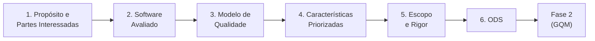

# Fase 1 - Estabelecimento dos Requisitos da Avaliação

<!-- Critério 8. Nível máximo: sumário funcionando, hierarquia consistente, storytelling claro, referências cruzadas completas. -->

Esta fase corresponde à primeira etapa do processo de avaliação de produto de software definido pela norma **ISO/IEC 25040**, na qual são estabelecidos os requisitos postos no nosso projeto.

Nela são definidos o propósito da avaliação, quem a demanda e quem usará seus resultados, qual produto será avaliado, qual modelo de qualidade servirá de referência, quais características serão priorizadas e qual o escopo e o rigor do trabalho. Esta página apresenta a síntese de cada decisão; o detalhamento está nas páginas indicadas em cada seção. Todas as decisões desta fase alimentam diretamente a Fase 2 (especificação da avaliação por meio do método GQM).

## 1.1 Objetivo da Avaliação

O objetivo desta avaliação é analisar a qualidade do **SIGAA** (Sistema Integrado de Gestão de Atividades Acadêmicas) utilizado pela **Universidade de Brasília (UnB)**. O SIGAA é a base funcional de organização para estudantes, docentes e parte dos servidores técnico-administrativos da instituição, abrangendo funcionalidades como matrícula em disciplinas, consulta de notas e menções, visualização de turmas e horários e visualização da grade curricular.

A avaliação tem como finalidade identificar pontos fortes e fracos no que diz respeito à consulta da grade e ao planejamento do fluxo no SIGAA, tendo como referencial a experiência dos estudantes e a existência de ferramentas de terceiros que se consolidaram por serem mais acessíveis ou por suprirem necessidades que o SIGAA não atende.

Em síntese:

- **Propósito:** identificar, com evidências mensuráveis, os pontos fracos do SIGAA nas tarefas acadêmicas mais frequentes do estudante, para apoiar a priorização de melhorias pela Secretaria de Tecnologia da Informação (STI/UnB) e embasar a ação de melhoria exigida na Fase 4.
- **Ponto de vista:** estudante de graduação da UnB, com atenção a perfis vulneráveis (calouros, estudantes com deficiência e estudantes que acessam o sistema apenas pelo celular).

O requisitante, os perfis de usuários e as demais partes interessadas estão detalhados em [Propósito e Partes Interessadas](proposito-stakeholders.md).

## 1.2 Produto de Software Avaliado

O **SIGAA** é um sistema web integrado de gestão acadêmica desenvolvido originalmente pela **Universidade Federal do Rio Grande do Norte (UFRN)**. O sistema foi adotado por diversas universidades federais brasileiras, incluindo a UnB, como solução institucional para a administração de atividades acadêmicas.

Entre as principais funcionalidades do SIGAA, destacam-se:

- **Matrícula em disciplinas** e gerenciamento de turmas;
- **Consulta de notas**, menções e histórico acadêmico;
- **Visualização de horários** e calendário acadêmico;
- **Gestão de processos institucionais**, como trancamento de disciplinas, aproveitamento de créditos e emissão de documentos;
- **Comunicação** entre discentes e docentes por meio de fóruns e notícias das turmas.

O SIGAA opera como uma aplicação web e é acessado a partir de uma ampla variedade de dispositivos.

A identificação da versão avaliada, o tipo de produto, os módulos do portal do discente, o diagrama de contexto, as telas de referência e as observações preliminares da interface (OP-01 a OP-08) estão em [Software Avaliado](software-avaliado.md).

## 1.3 Modelo de Qualidade

O modelo de qualidade adotado nesta avaliação é o definido pela norma **ISO/IEC 25010**, que integra a família de normas **SQuaRE** (*Systems and software Quality Requirements and Evaluation* — ISO/IEC 25000). Utiliza-se a versão de **2023**, que substitui a de 2011 e organiza a qualidade do produto em **9 características de qualidade** (entre parênteses, o nome correspondente na versão de 2011):

1. Adequação Funcional
2. Eficiência de Desempenho
3. Compatibilidade
4. Capacidade de Interação (Usabilidade)
5. Confiabilidade
6. Segurança
7. Manutenibilidade
8. Flexibilidade (Portabilidade)
9. Segurança Operacional (*Safety*, sem correspondente em 2011)

Cada característica é subdividida em subcaracterísticas que permitem uma avaliação mais detalhada e precisa dos diferentes aspectos de qualidade do software.

O modelo foi adaptado ao contexto do SIGAA: características e subcaracterísticas foram mantidas ou removidas conforme a relevância para as partes interessadas, a mensurabilidade em avaliação caixa-preta e a viabilidade ética da medição. A correspondência completa entre as versões, as adaptações justificadas e o diagrama do modelo estão em [Modelo de Qualidade](modelo-qualidade.md).

## 1.4 Características de Qualidade Selecionadas

Para esta avaliação, foram selecionadas **quatro características de qualidade** da ISO/IEC 25010, consideradas as mais relevantes para o contexto de uso do SIGAA na UnB. A seleção foi feita por uma **matriz Impacto x Risco** com filtro de viabilidade de medição, que também definiu a ordem de prioridade:

*Tabela 1 - Características selecionadas, em ordem de prioridade.*

| Prioridade | Característica | Prioridade (P = I x R) |
| :---: | :--- | :---: |
| 1 | Capacidade de Interação (Usabilidade) | 25 |
| 2 | Adequação Funcional | 20 |
| 3 | Eficiência de Desempenho | 16 |
| 4 | Flexibilidade (Portabilidade) | 16 |

*Fonte: elaboração da equipe. Método, notas e trade-offs em [Características Priorizadas](caracteristicas.md).*

A justificativa para cada seleção é apresentada a seguir.

### 1.4.1 Adequação Funcional

A Adequação Funcional avalia o grau em que o software fornece funções que atendem às necessidades declaradas e implícitas dos usuários. Suas subcaracterísticas são: **completude funcional**, **correção funcional** e **adequação funcional** (pertinência).

**Justificativa:** O SIGAA é o sistema central de gestão acadêmica da UnB, sendo utilizado para atividades essenciais como matrícula, consulta de notas e acompanhamento de turmas. É fundamental que o sistema ofereça todas as funções necessárias, que essas funções produzam resultados corretos e que sejam adequadas às tarefas dos usuários. Falhas nessa característica impactam diretamente a vida acadêmica de milhares de estudantes, docentes e servidores. Além disso, a existência de ferramentas de terceiros para planejar o fluxo de disciplinas (observação OP-07) é um indício de lacunas de completude.

### 1.4.2 Capacidade de Interação (Usabilidade)

A Capacidade de Interação (Usabilidade, na versão de 2011) avalia o grau em que o software pode ser utilizado por usuários específicos para atingir objetivos com eficácia, eficiência e satisfação. Nesta avaliação, são consideradas as subcaracterísticas: **reconhecimento de adequação**, **apreensibilidade**, **operabilidade**, **proteção contra erros do usuário**, **inclusividade** (acessibilidade, em 2011) e **autodescritividade**.

**Justificativa:** O SIGAA possui uma base de usuários diversificada, composta por estudantes de graduação e pós-graduação, docentes e técnicos administrativos, com diferentes níveis de proficiência tecnológica. Para calouros e estudantes com deficiência, problemas de interação podem impedir a conclusão de tarefas obrigatórias. É também a característica com mais indícios na inspeção inicial (OP-01 a OP-06), o que lhe conferiu a maior prioridade na matriz.

### 1.4.3 Flexibilidade (Portabilidade)

A Flexibilidade (Portabilidade, na versão de 2011) avalia o grau de eficácia e eficiência com que o software pode ser transferido de um ambiente para outro. Suas subcaracterísticas são: **adaptabilidade**, **escalabilidade**, **capacidade de instalação** e **capacidade de substituição**; apenas a **adaptabilidade** é avaliada, pois as demais não se aplicam a um sistema web sem instalação no cliente ou exigem acesso ao servidor.

**Justificativa:** Os usuários acessam o SIGAA a partir de diferentes dispositivos (computadores de mesa, notebooks, tablets e smartphones) e navegadores web (Chrome, Firefox, Safari, Edge, entre outros). Avaliar a adaptabilidade do sistema a diferentes ambientes de execução e a consistência da experiência de acesso em múltiplas plataformas é relevante para garantir que todos os usuários possam utilizar o sistema de forma adequada, independentemente do dispositivo ou navegador empregado, principalmente em uma universidade pública, com um público amplo e com limitações orçamentárias. Por isso, é importante saber se o SIGAA é inclusivo e democrático.

### 1.4.4 Eficiência de Desempenho

A Eficiência de Desempenho avalia o desempenho do software em relação à quantidade de recursos utilizados sob condições estabelecidas. Nesta avaliação, são consideradas as subcaracterísticas **comportamento temporal** e **utilização de recursos** (medida no cliente); a **capacidade** foi excluída por exigir testes de carga, que seriam intrusivos em produção.

**Justificativa:** A lentidão atrasa todas as tarefas do estudante e é agravada em redes móveis, usadas sobretudo pelos estudantes de menor renda. A interface do SIGAA gera páginas com muitos elementos e requisições, e há relatos recorrentes de lentidão em horários de pico. A característica empatou com a Flexibilidade (P = 16) e ambas foram mantidas por atenderem a aspectos complementares: o custo de cada interação e a possibilidade de interagir em diferentes ambientes.

As características não selecionadas (Confiabilidade, Segurança, Manutenibilidade, Compatibilidade e Segurança Operacional), os motivos de cada corte e as relações esperadas entre as características selecionadas estão em [Características Priorizadas](caracteristicas.md#4-trade-offs-e-caracteristicas-nao-selecionadas).

## 1.5 Escopo da Avaliação

O escopo desta avaliação está delimitado aos **módulos voltados ao discente** do SIGAA na UnB, com foco na **interface web** do sistema. Serão consideradas as funcionalidades mais utilizadas pelos estudantes, tais como:

- Visualização do fluxo de disciplinas;
- Consulta de notas e menções;
- Visualização de turmas e horários;
- Acesso ao histórico acadêmico;
- Navegação geral pelo sistema.

A avaliação considerará a **versão do sistema disponível durante o 2º semestre letivo de 2026**, refletindo o estado atual do produto em uso pela comunidade universitária.

Essas funcionalidades foram organizadas em **seis tarefas representativas (T1 a T6)**, executadas sem acesso a código-fonte, banco de dados ou infraestrutura. As tarefas, os ambientes de execução, a profundidade por característica, os itens excluídos e os limites de validade dos resultados estão em [Escopo e Rigor](escopo.md).

## 1.6 Rigor da Avaliação

A avaliação seguirá uma abordagem sistemática fundamentada no processo de avaliação de produto de software definido pela **ISO/IEC 25040**, contemplando:

- **Definição de métricas** de qualidade alinhadas às características e subcaracterísticas selecionadas da ISO/IEC 25010;
- **Procedimentos de coleta de dados** estruturados, incluindo inspeção da interface, testes exploratórios e análise heurística;
- **Critérios de interpretação e julgamento** dos resultados obtidos, com níveis de pontuação claramente definidos.

O rigor adotado busca garantir a reprodutibilidade e a objetividade da avaliação, de forma compatível com o contexto acadêmico da disciplina de Qualidade de Software 1 (FGA0315).

O nível de rigor adotado é **intermediário**, pois a avaliação apoia decisões de priorização de melhorias e não é uma certificação. As garantias de rigor e as limitações aceitas estão em [Escopo e Rigor](escopo.md#7-rigor-da-avaliacao).

## 1.7 Objetivos de Desenvolvimento Sustentável

A avaliação relaciona-se ao **ODS 4** (Educação de Qualidade), ao **ODS 10** (Redução das Desigualdades) e ao **ODS 16** (Instituições Eficazes). As metas, os indicadores e a pertinência de cada um ao SIGAA estão em [ODS](ods.md).

## 1.8 Mapa da Fase 1

*Tabela 2 - Relação entre as tarefas da atividade 1 da ISO/IEC 25040 e as páginas desta fase.*

| Tarefa da ISO/IEC 25040 | Seção | Onde está detalhada |
| :--- | :---: | :--- |
| Estabelecer o propósito da avaliação | 1.1 | [Propósito e Partes Interessadas](proposito-stakeholders.md) |
| Identificar requisitante e partes interessadas | 1.1 | [Propósito e Partes Interessadas](proposito-stakeholders.md) |
| Identificar o tipo de produto e as partes a avaliar | 1.2 | [Software Avaliado](software-avaliado.md) |
| Especificar o modelo de qualidade | 1.3 | [Modelo de Qualidade](modelo-qualidade.md) |
| Obter e priorizar os requisitos de qualidade | 1.4 | [Características Priorizadas](caracteristicas.md) |
| Definir escopo, profundidade e rigor da avaliação | 1.5 e 1.6 | [Escopo e Rigor](escopo.md) |
| Relacionar a avaliação a objetivos de desenvolvimento sustentável | 1.7 | [ODS](ods.md) |

*Fonte: elaboração da equipe, com base na ISO/IEC 25040.*

*Figura 1 - Encadeamento das decisões da Fase 1 até a Fase 2. Fonte: elaboração da equipe.*

Cada página traz, ao final, um histórico de versão. As referências utilizadas estão consolidadas em [Referências](../referencias.md) e o uso de ferramentas de IA está declarado em [Uso de IA](../uso-de-ia.md).

## Histórico de Versão

| Versão | Data | Descrição | Autor |
| :----: | :--: | :-------: | :---: |
| 1.0 | 16/10/2026 | Criação do documento da Fase 1 | [Davi Nobre](https://github.com/Jagaima) |
| 1.1 | 16/10/2026 | Parte da documentação da Fase 1 adicionada (métricas, rigor, características escolhidas) | [Davi Nobre](https://github.com/Jagaima) |
| 1.2 | 18/10/2026 | Integração com as páginas detalhadas da Fase 1: síntese do propósito, atualização para a ISO/IEC 25010:2023, inclusão da Eficiência de Desempenho (1.4.4) com a priorização Impacto x Risco, seções 1.7 (ODS) e 1.8 (mapa da fase) e referências cruzadas | Caio Borges |
| 1.3 | 19/10/2026 | Revisão de português e registro na seção 1.1 e na justificativa de Flexibilidade, sem alteração de conteúdo | Arthur Leite |
