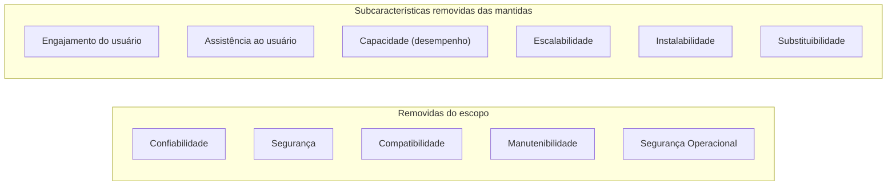

# Modelo de Qualidade

<!-- Critério 4. Nível máximo: adaptações justificadas por contexto e stakeholders; diagrama organizado, com ligações às subcaracterísticas. -->

## 1. Modelo base

O modelo de referência é o **modelo de qualidade de produto da ISO/IEC 25010:2023**, que integra a família SQuaRE (ISO/IEC 25000). A versão de 2023 substitui a de 2011 e organiza a qualidade do produto em **nove características**. Como parte da literatura e do material da disciplina ainda usa a nomenclatura de 2011, a Tabela 1 apresenta a correspondência entre as versões.

*Tabela 1 - Características da ISO/IEC 25010:2023 e correspondência com a versão de 2011.*

| ISO/IEC 25010:2023 | ISO/IEC 25010:2011 | Subcaracterísticas (2023) |
| :--- | :--- | :--- |
| Adequação Funcional | Adequação Funcional | Completude, correção e adequação (pertinência) funcional |
| Eficiência de Desempenho | Eficiência de Desempenho | Comportamento temporal, utilização de recursos, capacidade |
| Compatibilidade | Compatibilidade | Coexistência, interoperabilidade |
| Capacidade de Interação | Usabilidade | Reconhecimento de adequação, apreensibilidade, operabilidade, proteção contra erros do usuário, engajamento do usuário, inclusividade, assistência ao usuário, autodescritividade |
| Confiabilidade | Confiabilidade | Isenção de falhas, disponibilidade, tolerância a falhas, recuperabilidade |
| Segurança | Segurança | Confidencialidade, integridade, não repúdio, responsabilização, autenticidade, resistência |
| Manutenibilidade | Manutenibilidade | Modularidade, reusabilidade, analisabilidade, modificabilidade, testabilidade |
| Flexibilidade | Portabilidade | Adaptabilidade, escalabilidade, instalabilidade, substituibilidade |
| Segurança Operacional (*Safety*) | (não existia) | Restrição operacional, identificação de riscos, falha segura, alerta de perigo, integração segura |

*Fonte: elaboração da equipe, com base na ISO/IEC 25010:2011 e na ISO/IEC 25010:2023.*

Neste documento, as características renomeadas aparecem com a nomenclatura de 2023 seguida da de 2011 entre parênteses: **Capacidade de Interação (Usabilidade)** e **Flexibilidade (Portabilidade)**.

## 2. Adaptações ao contexto do SIGAA

O modelo não foi aplicado "de prateleira". Cada característica e subcaracterística foi mantida ou removida considerando três filtros:

1. **Relevância para as partes interessadas** definidas em [Propósito e Partes Interessadas](proposito-stakeholders.md), em especial o estudante;
2. **Mensurabilidade em avaliação caixa-preta**, conforme as implicações descritas em [Software Avaliado](software-avaliado.md#5-implicacoes-para-a-avaliacao);
3. **Viabilidade ética e operacional**: nenhum teste pode alterar dados reais, sobrecarregar o ambiente de produção ou violar termos de uso.

*Tabela 2 - Adaptação do modelo ao SIGAA.*

| Característica | Decisão | Subcaracterísticas mantidas | Justificativa (contexto e partes interessadas) |
| :--- | :--- | :--- | :--- |
| Adequação Funcional | **Mantida** | Completude, correção, adequação | O estudante depende do SIGAA para tarefas sem alternativa institucional; funções ausentes geram uso de ferramentas não oficiais (observação OP-07) e dados incorretos afetam decisões acadêmicas. |
| Capacidade de Interação (Usabilidade) | **Mantida** | Reconhecimento de adequação, apreensibilidade, operabilidade, proteção contra erros do usuário, inclusividade, autodescritividade | É a característica mais citada nas queixas dos estudantes e com mais indícios na inspeção (OP-01 a OP-06). Engajamento e assistência ao usuário foram removidas: a primeira é subjetiva demais para o prazo do projeto e a segunda depende de canais de suporte fora da interface. |
| Eficiência de Desempenho | **Mantida** | Comportamento temporal, utilização de recursos (no cliente) | Tempo de resposta afeta todos os perfis, sobretudo quem usa rede móvel. A subcaracterística capacidade foi removida porque exige testes de carga, que seriam intrusivos em produção. |
| Flexibilidade (Portabilidade) | **Mantida** | Adaptabilidade | Parte relevante dos estudantes acessa o sistema por celular e por navegadores variados (OP-02, OP-03). Instalabilidade e substituibilidade não se aplicam a um sistema web sem instalação no cliente; escalabilidade exige acesso ao servidor. |
| Confiabilidade | Removida | - | Indisponibilidades ocorrem sobretudo em picos (matrícula) e exigiriam monitoramento contínuo durante meses; falhas pontuais observadas serão registradas como não conformidades de Adequação Funcional. |
| Segurança | Removida | - | A avaliação externa de segurança exigiria testes de invasão, não autorizados e antiéticos em um sistema de produção com dados pessoais. |
| Compatibilidade | Removida | - | A integração com outros sistemas SIG não é observável pelo estudante; o aspecto de navegadores diferentes é tratado em Flexibilidade. |
| Manutenibilidade | Removida | - | Não há acesso ao código-fonte, à arquitetura nem ao processo de desenvolvimento. |
| Segurança Operacional | Removida | - | O sistema não controla equipamentos nem processos que possam causar dano físico, ambiental ou à vida. |

*Fonte: elaboração da equipe.*

A priorização entre as características, com o método e as notas atribuídas, está em [Características Priorizadas](caracteristicas.md).

## 3. Representação gráfica

```mermaid
graph TD
    M["Modelo de Qualidade do SIGAA/UnB<br/>(ISO/IEC 25010:2023 adaptado)"]

    M --> AF["Adequação Funcional"]
    M --> CI["Capacidade de Interação<br/>(Usabilidade)"]
    M --> ED["Eficiência de Desempenho"]
    M --> FX["Flexibilidade<br/>(Portabilidade)"]

    AF --> AF1["Completude funcional<br/>funções necessárias ao estudante existem"]
    AF --> AF2["Correção funcional<br/>dados e documentos corretos"]
    AF --> AF3["Adequação funcional<br/>tarefas concluídas sem passos desnecessários"]

    CI --> CI1["Reconhecimento de adequação<br/>estudante identifica onde está cada função"]
    CI --> CI2["Apreensibilidade<br/>calouro aprende a usar sem ajuda"]
    CI --> CI3["Operabilidade<br/>navegação e controles fáceis de operar"]
    CI --> CI4["Proteção contra erros<br/>prevenção e recuperação de erros e expiração de sessão"]
    CI --> CI5["Inclusividade<br/>uso por pessoas com deficiência"]
    CI --> CI6["Autodescritividade<br/>informações compreensíveis sem legenda externa"]

    ED --> ED1["Comportamento temporal<br/>tempo de carregamento e resposta das páginas"]
    ED --> ED2["Utilização de recursos<br/>peso das páginas e requisições no cliente"]

    FX --> FX1["Adaptabilidade<br/>funcionamento em navegadores, telas e toque"]

    classDef carac fill:#e8eaf6,stroke:#3f51b5,stroke-width:2px
    class AF,CI,ED,FX carac
```

*Figura 1 - Modelo de qualidade adaptado ao SIGAA/UnB, com as subcaracterísticas mantidas e o foco de cada uma no contexto do estudante. Fonte: elaboração da equipe, com base na ISO/IEC 25010:2023.*

*Figura 2 - Elementos do modelo base excluídos da avaliação (justificativas na Tabela 2). Fonte: elaboração da equipe.*

## Histórico de Versão

| Versão | Data | Descrição | Autor |
| :----: | :--: | :-------: | :---: |
| 1.0 | 16/10/2026 | Criação do documento: modelo base ISO/IEC 25010:2023, correspondência com 2011, adaptações justificadas e diagramas | Caio Borges |
