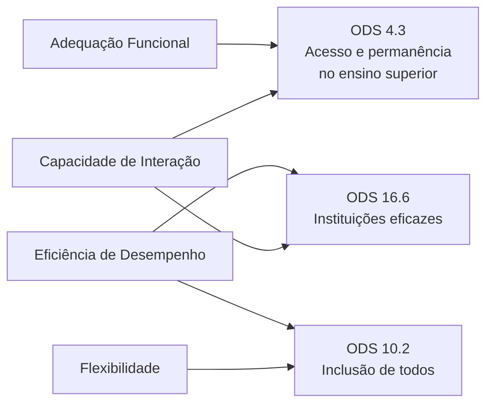

# Objetivos de Desenvolvimento Sustentável (ODS)

<!-- Critério 7. Nível máximo: vínculo bem justificado com metas/indicadores; explica pertinência ao software. -->

## 1. Contexto

Os Objetivos de Desenvolvimento Sustentável compõem a Agenda 2030 da Organização das Nações Unidas. No Brasil, as metas foram adaptadas à realidade nacional pelo Instituto de Pesquisa Econômica Aplicada (IPEA). Como sistema público que media o acesso dos estudantes à universidade, o SIGAA se relaciona diretamente com metas de educação, inclusão e qualidade das instituições públicas.

## 2. ODS selecionados

*Tabela 1 - ODS, metas e relação com a avaliação.*

| ODS | Meta | Indicador de referência | Característica avaliada que contribui |
| :--- | :--- | :--- | :--- |
| ODS 4 - Educação de Qualidade | 4.3 - Assegurar a igualdade de acesso à educação técnica, profissional e superior de qualidade | 4.3.1 - Taxa de participação na educação formal | Adequação Funcional e Capacidade de Interação |
| ODS 10 - Redução das Desigualdades | 10.2 - Empoderar e promover a inclusão social, econômica e política de todos, independentemente de idade, gênero, deficiência, raça, etnia, origem, religião, condição econômica ou outra | 10.2.1 - Proporção de pessoas vivendo abaixo de 50% da renda mediana | Flexibilidade, Eficiência de Desempenho e inclusividade |
| ODS 16 - Paz, Justiça e Instituições Eficazes | 16.6 - Desenvolver instituições eficazes, responsáveis e transparentes em todos os níveis | 16.6.2 - Proporção da população satisfeita com sua última experiência com serviços públicos | Capacidade de Interação e Eficiência de Desempenho |

*Fonte: elaboração da equipe, com base na Agenda 2030 (ONU) e nas metas nacionais (IPEA).*

## 3. Pertinência ao SIGAA

### 3.1 ODS 4 - Educação de Qualidade (meta 4.3)

O acesso ao ensino superior não termina no ingresso: a permanência depende de o estudante conseguir se matricular, acompanhar notas, cumprir prazos e planejar a integralização do curso. Todas essas ações passam pelo SIGAA. Funções ausentes ou difíceis de usar aumentam a chance de erros de planejamento e perda de prazos, com efeito maior sobre calouros e estudantes de primeira geração na universidade.

**Contribuição da avaliação:** as métricas de Adequação Funcional (completude e correção das funções nas tarefas T1 a T6) e de Capacidade de Interação (taxa de conclusão de tarefas por calouros) indicam se o sistema favorece ou dificulta a permanência, contribuindo indiretamente para o indicador 4.3.1.

### 3.2 ODS 10 - Redução das Desigualdades (meta 10.2)

Estudantes de menor renda dependem com mais frequência apenas do celular e de redes móveis com franquia limitada. Estudantes com deficiência dependem de recursos de acessibilidade. Um sistema que funciona bem apenas em computador com rede estável **transfere a desvantagem social para a vida acadêmica**.

**Contribuição da avaliação:** a avaliação de Flexibilidade (conclusão de tarefas no celular), de Eficiência de Desempenho (peso das páginas e tempo em rede móvel) e da inclusividade (critérios de acessibilidade) mede o quanto o SIGAA é igualmente utilizável por todos os perfis definidos em [Propósito e Partes Interessadas](proposito-stakeholders.md#22-perfis-de-usuarios-considerados).

### 3.3 ODS 16 - Instituições Eficazes (meta 16.6)

O SIGAA é um serviço público digital. A meta 16.6 trata de instituições eficazes, e o indicador 16.6.2 mede diretamente a satisfação da população com serviços públicos.

**Contribuição da avaliação:** as medidas de satisfação e eficiência na execução das tarefas, previstas para Capacidade de Interação, produzem dados alinhados ao indicador 16.6.2 no contexto da UnB. Ao publicar os dados e o método no repositório, o projeto também contribui para a transparência.

## 4. Síntese

*Figura 1 - Relação entre as características avaliadas e as metas dos ODS. Fonte: elaboração da equipe.*

## Histórico de Versão

| Versão | Data | Descrição | Autor |
| :----: | :--: | :-------: | :---: |
| 1.0 | 16/10/2026 | Criação do documento: ODS 4, 10 e 16, com metas, indicadores e pertinência ao SIGAA | Caio Borges |
