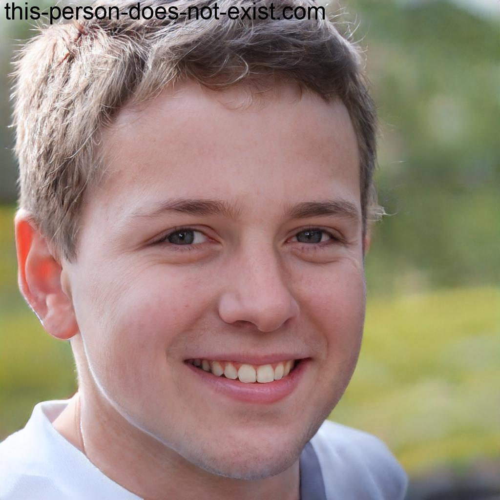
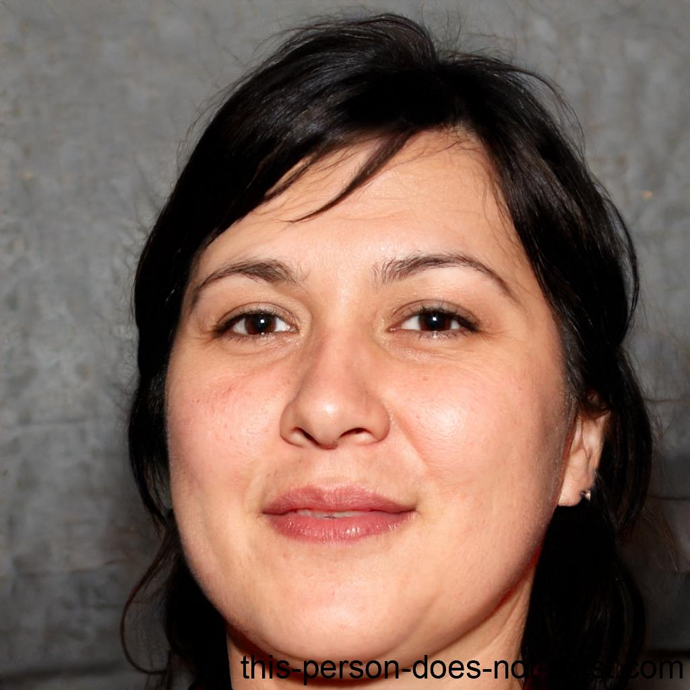

# Personas

<!-- Critério 2. As personas complementam os perfis de usuários definidos em Propósito e Partes Interessadas, dando concretude aos comportamentos, necessidades e frustrações que orientam a avaliação. -->

As personas abaixo foram elaboradas a partir dos [perfis de usuários](proposito-stakeholders.md#22-perfis-de-usuarios-considerados) e das [partes interessadas](proposito-stakeholders.md#23-partes-interessadas) definidas na Fase 1. Cada persona representa um arquétipo dos usuários do SIGAA/UnB, com foco nas tarefas do [escopo da avaliação](escopo.md#21-tarefas-representativas) — especialmente consulta de horários, grade curricular e fluxo de disciplinas.

A **antipersona** representa um perfil que **não** é público-alvo do SIGAA e, portanto, está fora do escopo da avaliação, ajudando a delimitar para quem o sistema deve funcionar.

---

## Persona 1 — Estudante de Graduação

*Figura 1 — Persona 1: Mariana Silva Oliveira (Estudante de Graduação). Fonte: elaboração da equipe.*

| Atributo | Descrição |
| :--- | :--- |
| **Nome** | Mariana Silva Oliveira |
| **Idade** | 19 anos |
| **Gênero** | Feminino |
| **Ocupação** | Estudante de Engenharia de Software — 2º semestre (caloura) |
| **Campus** | FCTE — Faculdade de Ciências e Tecnologias em Engenharia (Gama) |
| **Dispositivo principal** | Smartphone Android (acessa o SIGAA principalmente pelo celular) |
| **Experiência com tecnologia** | Intermediária — usa redes sociais e aplicativos de mensagem diariamente, mas não tem familiaridade com sistemas corporativos ou acadêmicos |

### Perfil e Contexto

Mariana ingressou na UnB pelo ENEM e está em seu primeiro ano de graduação. Vinda de escola pública, ela não possuía experiência prévia com sistemas de gestão acadêmica. Divide o tempo entre as aulas no campus Gama e um estágio em empresa de tecnologia no Plano Piloto. Não possui computador em casa — usa o celular para todas as tarefas acadêmicas e, ocasionalmente, os computadores do laboratório da faculdade.

### Necessidades

- Consultar os **horários das disciplinas** do próximo semestre para planejar a matrícula sem conflitos com o estágio;
- Visualizar a **grade curricular** do curso para entender quais disciplinas são obrigatórias e quais são optativas;
- Compreender o **fluxo de disciplinas** e os pré-requisitos para não se atrasar na formatura;
- Acompanhar **notas e menções** ao longo do semestre (tarefas T1 e T2 do escopo);
- Acessar **materiais publicados pelos professores** na Turma Virtual (tarefa T5).

### Expectativas

- Que o SIGAA funcione bem no **celular**, com menus acessíveis por toque e texto legível sem necessidade de zoom;
- Que a notação de horários (ex.: "24M34") tenha uma **legenda visível** ou seja substituída por um formato compreensível;
- Que a navegação seja **intuitiva**, sem precisar de tutoriais ou da ajuda de veteranos para tarefas básicas;
- Que o sistema seja **rápido**, especialmente em rede móvel.

### Frustrações

- Não entende o código de horário das turmas e precisa perguntar a colegas;
- Os menus do SIGAA não funcionam bem no celular — precisam do ponteiro do mouse para abrir;
- Tem dificuldade em encontrar onde fica o fluxo de disciplinas do curso;
- Desconhece os termos acadêmicos usados no sistema (IRA, menção, integralização).

### Perguntas norteadoras

1. A estudante caloura consegue localizar e interpretar o horário de uma turma sem ajuda externa?
2. Ela consegue navegar pelo fluxo de disciplinas usando apenas o celular?
3. A interface fornece apoio suficiente para que ela entenda a terminologia acadêmica (menção, IRA)?
4. O tempo de carregamento das páginas em rede móvel permite que ela complete suas tarefas sem frustração?

---

## Persona 2 — Aluno de Pós-Graduação

*Figura 2 — Persona 2: Rafael Mendes Costa (Aluno de Pós-Graduação). Fonte: elaboração da equipe.*

| Atributo | Descrição |
| :--- | :--- |
| **Nome** | Rafael Mendes Costa |
| **Idade** | 28 anos |
| **Gênero** | Masculino |
| **Ocupação** | Mestrando em Engenharia Eletrônica — 3º semestre |
| **Campus** | FCTE — Faculdade de Ciências e Tecnologias em Engenharia (Gama) |
| **Dispositivo principal** | Notebook com Windows e, eventualmente, celular |
| **Experiência com tecnologia** | Alta — é engenheiro de formação, utiliza ferramentas de desenvolvimento e sistemas diversos |

### Perfil e Contexto

Rafael concluiu a graduação em Engenharia Elétrica pela UnB em 2024 e retornou para o mestrado. Já conhece o SIGAA desde a graduação, mas percebe que as funcionalidades para a pós-graduação são organizadas de forma diferente. Ele cursa disciplinas tanto no programa de pós quanto como aluno especial em disciplinas de graduação, o que o obriga a navegar por partes distintas do sistema. Trabalha como pesquisador bolsista e precisa gerenciar seu tempo entre pesquisa, disciplinas e orientação.

### Necessidades

- Consultar as **disciplinas ofertadas** pelo programa de pós-graduação e verificar compatibilidade de horários com disciplinas de graduação;
- Acompanhar o **histórico e os créditos** acumulados no programa de mestrado;
- Acessar **materiais das turmas virtuais** de diferentes programas e departamentos (tarefa T5);
- Verificar **prazos acadêmicos** no calendário, como datas de qualificação e defesa (tarefa T6);
- Consultar e emitir **documentos acadêmicos** como atestado de matrícula e histórico (tarefa T3).

### Expectativas

- Que a transição entre os módulos de **graduação e pós-graduação** seja clara e fluida;
- Que o sistema permita visualizar de forma consolidada os créditos da pós, sem precisar calcular manualmente;
- Que o calendário acadêmico da pós-graduação esteja integrado ao calendário geral do SIGAA;
- Que a emissão de documentos funcione sem erros ou necessidade de deslocamento à secretaria.

### Frustrações

- O módulo de pós-graduação tem layout e organização diferentes do de graduação, causando confusão;
- Algumas funcionalidades que existem para a graduação não estão disponíveis ou não são acessíveis para alunos de pós;
- O SIGAA não oferece uma visão unificada dos horários de aulas da graduação e da pós quando ele cursa disciplinas em ambos;
- O sistema é lento ao carregar listas de turmas de outros departamentos.

### Perguntas norteadoras

1. O pós-graduando consegue visualizar seus horários e créditos de forma consolidada no SIGAA?
2. A navegação entre os módulos de graduação e pós-graduação é intuitiva ou causa confusão?
3. O sistema apresenta os prazos acadêmicos da pós-graduação de forma clara e acessível?
4. Funcionalidades disponíveis na graduação (como visualização do fluxo) são igualmente acessíveis para a pós?

---

## Persona 3 — Professora

*Figura 3 — Persona 3: Profa. Dra. Ana Beatriz Ferreira Lima (Docente). Fonte: elaboração da equipe.*

| Atributo | Descrição |
| :--- | :--- |
| **Nome** | Ana Beatriz Ferreira Lima |
| **Idade** | 42 anos |
| **Gênero** | Feminino |
| **Ocupação** | Professora Adjunta do Departamento de Engenharia de Software |
| **Campus** | FCTE — Faculdade de Ciências e Tecnologias em Engenharia (Gama) |
| **Dispositivo principal** | Notebook macOS e, raramente, smartphone iOS |
| **Experiência com tecnologia** | Alta — utiliza ferramentas de desenvolvimento, plataformas de ensino e sistemas acadêmicos há mais de 15 anos |

### Perfil e Contexto

Ana Beatriz leciona disciplinas de graduação e pós-graduação na FCTE. Tem sob sua responsabilidade turmas com 40 a 80 alunos por semestre. Além de ensinar, coordena projetos de pesquisa e extensão. Utiliza o SIGAA diariamente para lançar notas, publicar materiais na Turma Virtual, consultar listas de frequência e verificar horários. É exigente com a qualidade das ferramentas que utiliza e critica a falta de usabilidade do sistema, mas reconhece que não há alternativa institucional.

### Necessidades

- Consultar a **grade de horários** das turmas que ministra para evitar conflitos com reuniões e orientações;
- Verificar os **horários das disciplinas** dos outros docentes do departamento para propor colaborações e evitar sobreposição;
- Publicar **materiais e avisos** na Turma Virtual de forma rápida (impacta diretamente a tarefa T5 dos estudantes);
- Lançar **notas e menções** corretamente, garantindo que os estudantes as vejam sem erros (impacta a tarefa T1);
- Consultar o **calendário acadêmico** para prazos de lançamento de menções e trancamentos (tarefa T6).

### Expectativas

- Que o sistema permita publicar materiais e lançar notas sem muitos cliques e telas intermediárias;
- Que a visualização de horários das turmas seja legível e não dependa de códigos crípticos;
- Que o SIGAA funcione corretamente no Safari e no macOS, sem erros de compatibilidade;
- Que o sistema salve rascunhos automaticamente para evitar perda de trabalho durante o lançamento de notas.

### Frustrações

- O lançamento de notas exige muitas etapas e não tem salvamento automático — já perdeu dados por expiração de sessão;
- O formato de horários codificado dificulta a verificação rápida de conflitos;
- A Turma Virtual tem interface desatualizada e pouco intuitiva em comparação com plataformas como Moodle ou Google Classroom;
- Alguns recursos não funcionam bem no Safari (macOS), obrigando-a a usar outro navegador.

### Perguntas norteadoras

1. A professora consegue consultar e interpretar os horários das turmas do departamento de forma eficiente?
2. O processo de publicação de materiais na Turma Virtual é operável sem frustração?
3. O SIGAA funciona corretamente no navegador Safari (macOS) para as tarefas rotineiras da docente?
4. As informações publicadas pela professora (notas, materiais) são exibidas corretamente para os estudantes?

---

## Persona 4 — Servidor Técnico-Administrativo

*Figura 4 — Persona 4: Carlos Eduardo Ribeiro Santos (Servidor Técnico-Administrativo). Fonte: elaboração da equipe.*

| Atributo | Descrição |
| :--- | :--- |
| **Nome** | Carlos Eduardo Ribeiro Santos |
| **Idade** | 35 anos |
| **Gênero** | Masculino |
| **Ocupação** | Assistente Administrativo na Secretaria Acadêmica de Graduação (SAA) |
| **Campus** | Darcy Ribeiro (Plano Piloto) |
| **Dispositivo principal** | Computador desktop com Windows, fornecido pela universidade |
| **Experiência com tecnologia** | Intermediária — utiliza o SIGAA diariamente como ferramenta de trabalho, mas não tem formação técnica em TI |

### Perfil e Contexto

Carlos Eduardo trabalha na Secretaria Acadêmica há 8 anos. É responsável por atender estudantes que precisam de suporte para procedimentos acadêmicos — desde emissão de documentos até ajustes de matrícula. Lida diariamente com as dificuldades que os estudantes enfrentam no SIGAA, frequentemente recebendo solicitações presenciais de tarefas que poderiam ser feitas pelo sistema, mas que os alunos não conseguem completar sozinhos. Tem uma visão privilegiada dos problemas recorrentes do sistema, pois é o "ponto de escape" quando o estudante desiste de fazer algo sozinho.

### Necessidades

- Consultar **grades e horários de turmas** de diversos cursos para orientar estudantes durante o atendimento;
- Verificar a **situação acadêmica** dos estudantes (integralização, pendências, índices) para auxiliar em processos de matrícula e formatura (tarefa T4);
- Emitir **documentos acadêmicos** em nome de ou para estudantes (tarefa T3);
- Localizar informações no **calendário acadêmico** para informar prazos aos estudantes (tarefa T6);
- Identificar quais **disciplinas e turmas** estão disponíveis em cada semestre para responder dúvidas de matrícula.

### Expectativas

- Que o sistema permita buscar rapidamente informações de qualquer curso ou turma, sem navegações longas;
- Que a emissão de documentos e consulta de situação acadêmica sejam processos rápidos e sem erros;
- Que a interface seja estável e consistente, pois ele usa o sistema durante todo o expediente;
- Que as informações de horários e turmas sejam apresentadas de forma clara para repassar aos estudantes.

### Frustrações

- Atende muitos estudantes que não conseguiram consultar horários ou fluxo no SIGAA por conta própria;
- A busca de turmas por curso ou departamento é lenta e exige muitos filtros;
- A notação de horários (ex.: "35T23") dificulta a orientação dos alunos — ele mesmo precisa de uma tabela auxiliar impressa;
- Algumas informações que deveriam estar no sistema (como regras de pré-requisito ou fluxo sugerido) só estão disponíveis em documentos PDF avulsos nos sites das coordenações.

### Perguntas norteadoras

1. O servidor consegue localizar rapidamente os horários e turmas de um curso específico para orientar um estudante?
2. A informação de fluxo curricular e pré-requisitos está acessível no SIGAA ou depende de fontes externas?
3. O desempenho do sistema se mantém aceitável durante o expediente de atendimento (uso contínuo e prolongado)?
4. As consultas realizadas pelo servidor refletem os mesmos dados que o estudante vê no próprio portal?

---

## Antipersona — Cidadão Externo

*Figura 5 — Antipersona: Jorge Antônio Pereira de Souza (Cidadão Externo). Fonte: elaboração da equipe.*

| Atributo | Descrição |
| :--- | :--- |
| **Nome** | Jorge Antônio Pereira de Souza |
| **Idade** | 52 anos |
| **Gênero** | Masculino |
| **Ocupação** | Empresário do setor de construção civil |
| **Vínculo com a UnB** | Nenhum — não é estudante, servidor nem docente |
| **Dispositivo principal** | Smartphone Android |
| **Experiência com tecnologia** | Baixa — utiliza o celular basicamente para ligações, WhatsApp e consultas simples na internet |

### Perfil e Contexto

Jorge é pai de uma estudante da UnB e, por curiosidade, tenta acessar o SIGAA para ver os horários da filha e entender como funciona o sistema acadêmico. Ele não possui credenciais de acesso ao sistema e não tem vínculo institucional com a universidade. Eventualmente, acessa o site da UnB para buscar informações sobre vestibular, cursos e editais públicos, mas não é usuário do SIGAA.

### Por que é antipersona

Jorge **não faz parte do público-alvo** do SIGAA. O sistema é restrito a membros da comunidade universitária (estudantes, docentes e servidores técnico-administrativos) e requer autenticação institucional. As necessidades de Jorge — como consultar horários de aulas da filha ou entender a grade de um curso — poderiam ser atendidas por páginas públicas da universidade ou dos departamentos, mas **não são responsabilidade do SIGAA**.

Incluir Jorge como persona conduziria a avaliação a questionar funcionalidades públicas de consulta que estão **fora do propósito definido** na Fase 1. A avaliação foca exclusivamente no portal do discente autenticado, conforme o [escopo](escopo.md#1-objeto-da-avaliacao).

### Perguntas que Jorge faria (fora do escopo)

1. É possível consultar os horários de um curso da UnB sem ter login no SIGAA?
2. Onde encontro a grade curricular de Engenharia de Software para saber o que minha filha vai estudar?
3. Tem como acompanhar as notas de um estudante pelo sistema?

> **Nota:** Essas perguntas não são contempladas pela avaliação, pois envolvem acesso público não autenticado, que está excluído do escopo.

---

## Relação entre personas e tarefas do escopo

A tabela abaixo mostra quais [tarefas representativas](escopo.md#21-tarefas-representativas) são relevantes para cada persona, permitindo identificar quais perfis são mais exercitados pela avaliação.

*Tabela 1 — Relação entre personas e tarefas representativas.*

| Persona | T1 (Notas) | T2 (Horários) | T3 (Documentos) | T4 (Índices) | T5 (Turma Virtual) | T6 (Calendário) |
| :--- | :---: | :---: | :---: | :---: | :---: | :---: |
| Mariana (Estudante) | ✔ | ✔ | ✔ | ✔ | ✔ | ✔ |
| Rafael (Pós-Graduando) | ✔ | ✔ | ✔ | ✔ | ✔ | ✔ |
| Ana Beatriz (Professora) | — | ✔ | — | — | ✔ | ✔ |
| Carlos Eduardo (Servidor) | — | ✔ | ✔ | ✔ | — | ✔ |
| Jorge (Antipersona) | — | — | — | — | — | — |

*Fonte: elaboração da equipe.*

> A persona **Mariana** (estudante caloura) é a mais exercitada pelas seis tarefas, o que é coerente com o ponto de vista definido na [Fase 1](proposito-stakeholders.md): estudante de graduação da UnB.

## Histórico de Versão

| Versão | Data | Descrição | Autor |
| :----: | :--: | :-------: | :---: |
| 1.0 | 25/10/2026 | Criação do documento de personas: 4 personas e 1 antipersona, com perfis, necessidades, expectativas, frustrações e perguntas norteadoras | [Davi Nobre](https://github.com/Jagaima) |
