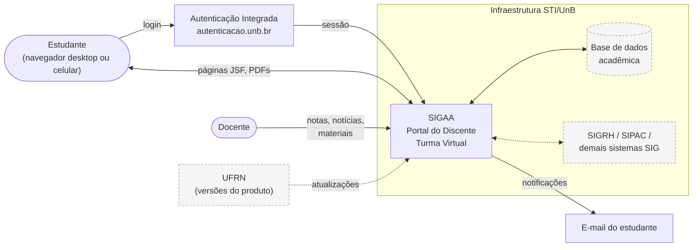
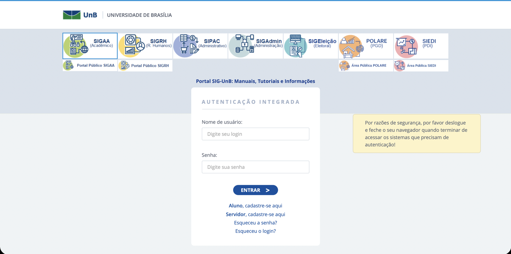
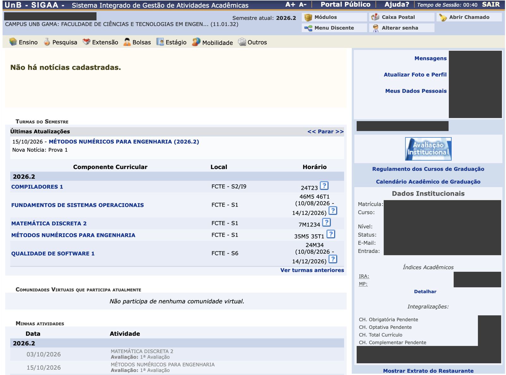
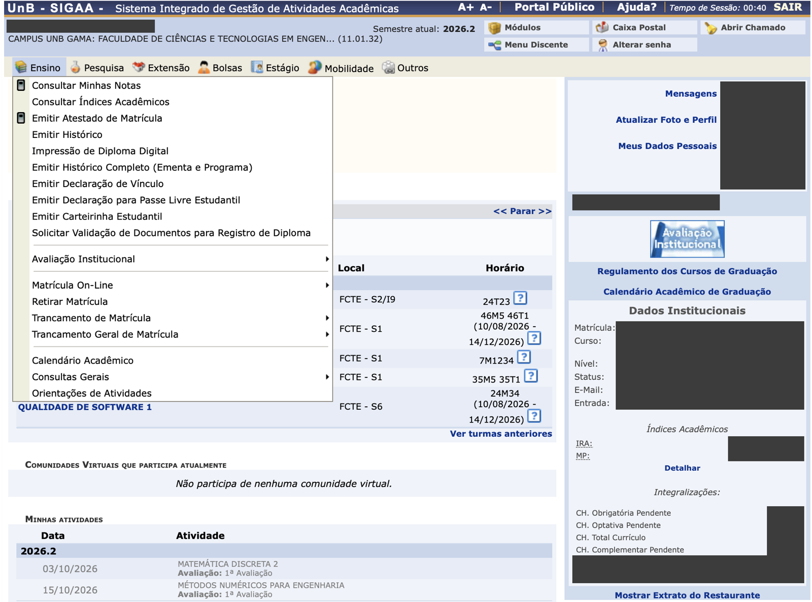
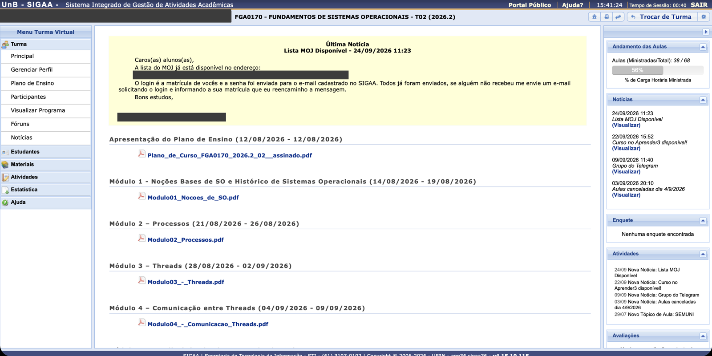
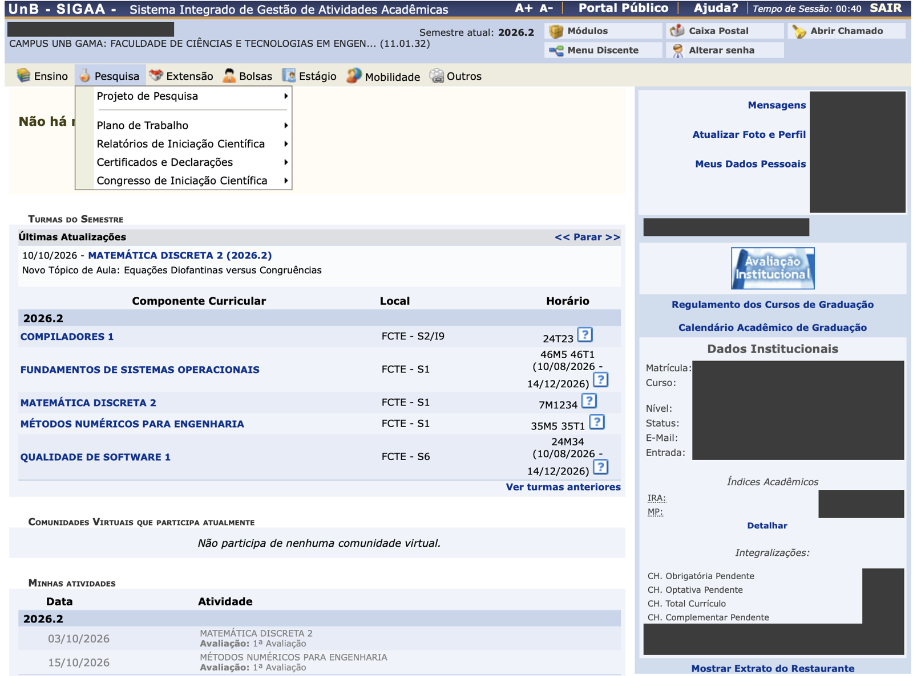
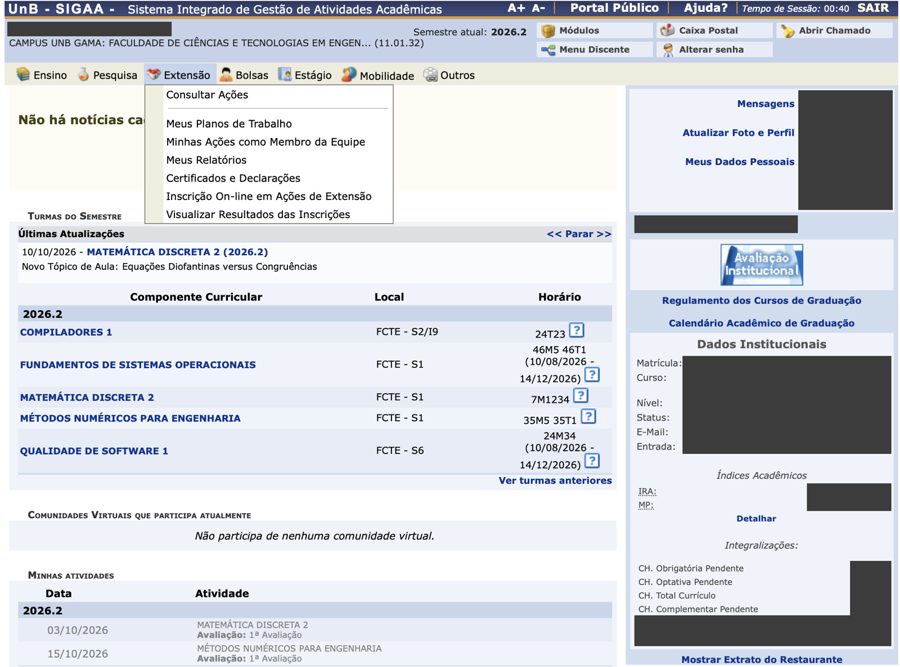
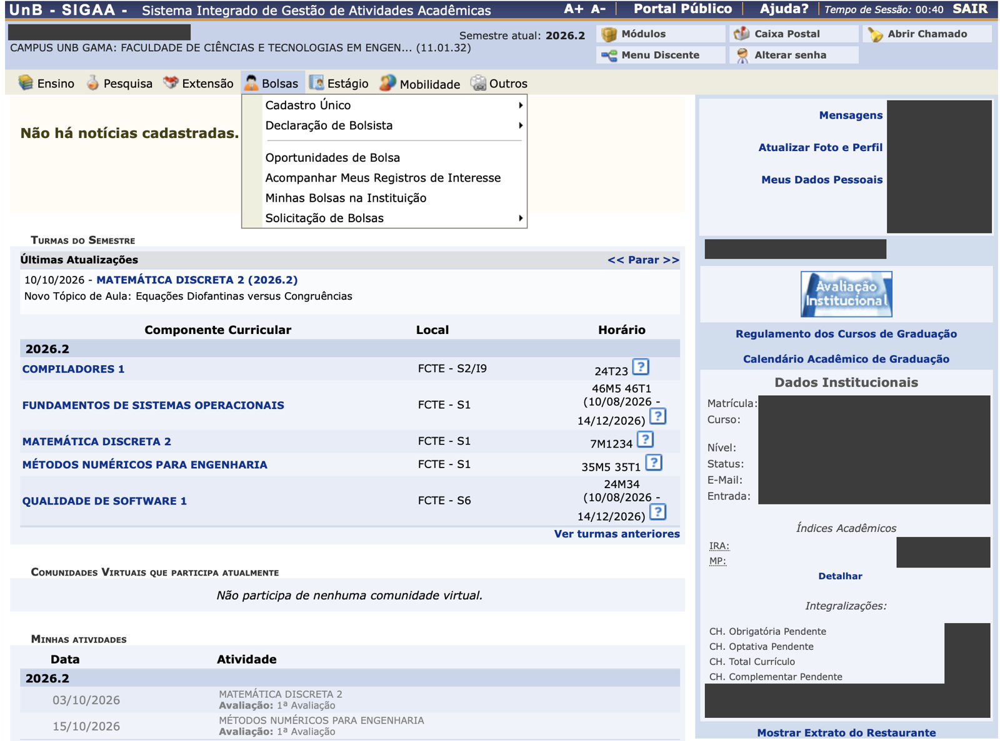
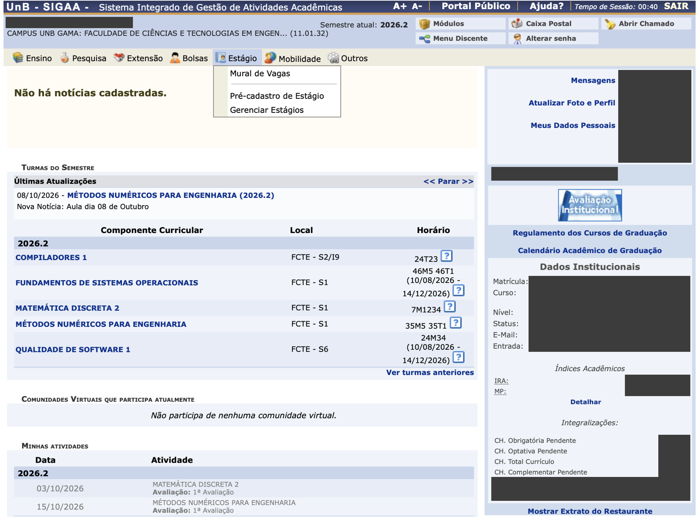

# Software Avaliado: SIGAA/UnB

<!-- Critério 3. Nível máximo: descrição completa com diagrama(s) (contexto/arquitetura) e implicações diretas para a avaliação (o que dá / não dá para medir agora). -->

## 1. Identificação

*Tabela 1 - Identificação do produto avaliado.*

| Item | Descrição |
| :--- | :--- |
| Nome | SIGAA - Sistema Integrado de Gestão de Atividades Acadêmicas |
| Instância avaliada | SIGAA da Universidade de Brasília |
| Endereço | <https://sigaa.unb.br> (portal do discente: `/sigaa/portais/discente/discente.jsf`) |
| Versão observada | v4.15.10.115 (informada no rodapé do sistema em 16/10/2026) |
| Desenvolvedor original | Universidade Federal do Rio Grande do Norte (UFRN), família de sistemas SIG |
| Operador local | Secretaria de Tecnologia da Informação da UnB (STI/UnB) |
| Tecnologia de interface | Aplicação web baseada em JavaServer Faces (páginas `.jsf`) |
| Acesso | Autenticação Integrada da UnB (`autenticacao.unb.br`), compartilhada com os demais sistemas SIG |
| Período de observação | 2º semestre letivo de 2026 |

*Fonte: elaboração da equipe, a partir da observação do sistema em 16/10/2026.*

## 2. Tipo de produto

O SIGAA é um **sistema de informação web, transacional e institucional**, do tipo *software* de prateleira customizado (produto desenvolvido por uma instituição e implantado, com configurações próprias, por outras). Do ponto de vista desta avaliação, ele é um **produto de código fechado**: a equipe tem acesso apenas à interface web em produção, com as credenciais de estudante de cada membro.

Essa classificação determina a natureza da avaliação: trata-se de uma **avaliação externa (caixa-preta)**, baseada no comportamento observável do sistema em uso, e não de uma avaliação interna (código, arquitetura, documentação técnica).

## 3. Descrição estruturada

### 3.1 Módulos do portal do discente

O portal do discente organiza as funções em menus horizontais. A Tabela 2 resume os módulos observados.

*Tabela 2 - Módulos do portal do discente e funções principais.*

| Módulo (menu) | Funções observadas |
| :--- | :--- |
| Ensino | Consultar notas, consultar índices acadêmicos, emitir atestado de matrícula, histórico, declaração de vínculo, declaração para passe livre, carteirinha estudantil, matrícula on-line, retirar matrícula, trancamento, calendário acadêmico, consultas gerais, avaliação institucional |
| Pesquisa | Projetos de pesquisa, planos de trabalho, relatórios e congresso de iniciação científica, certificados |
| Extensão | Consulta de ações, inscrição on-line em ações de extensão, planos de trabalho, relatórios, certificados |
| Bolsas | Cadastro único, oportunidades de bolsa, solicitação e acompanhamento de bolsas, declaração de bolsista |
| Estágio | Mural de vagas, pré-cadastro e gerenciamento de estágios |
| Mobilidade e Outros | Mobilidade acadêmica e funções complementares |
| Página inicial | Turmas do semestre com local e horário, últimas atualizações das turmas, atividades com prazo, dados institucionais, índices acadêmicos (IRA, MP) e integralização curricular |
| Turma Virtual | Plano de ensino, materiais, notícias, fóruns, atividades, participantes e andamento das aulas de cada turma |

*Fonte: elaboração da equipe, a partir das Figuras 2 a 5.*

### 3.2 Interfaces

- **Interface com o usuário:** navegador web, sem aplicativo oficial dedicado ao estudante. A página tem largura fixa e é organizada em menus suspensos acionados pelo ponteiro do mouse.
- **Autenticação:** serviço de Autenticação Integrada (*single sign-on*) compartilhado com SIGRH, SIPAC, SIGAdmin, SIGEleição, POLARE e SIEDI (Figura 2).
- **Saídas documentais:** documentos gerados em PDF (atestado, histórico, declarações), alguns com mecanismo de verificação de autenticidade.
- **Comunicação:** caixa postal interna e notificações por e-mail cadastradas no sistema.

### 3.3 Dependências e restrições

- **Dependência de infraestrutura institucional:** o rodapé indica execução em múltiplos servidores de aplicação (ex.: `app36.sigaa36`), operados pela STI/UnB.
- **Dependência de dados de outros sistemas e setores:** notas e materiais dependem do lançamento pelos docentes; dados de matrícula e currículo dependem da secretaria acadêmica.
- **Restrição de sessão:** a sessão expira por inatividade (contador visível no cabeçalho).
- **Restrição de calendário:** funções como matrícula on-line e trancamento só ficam disponíveis em períodos definidos pelo calendário acadêmico.
- **Restrição de acesso:** cada membro da equipe acessa apenas os próprios dados; não há ambiente de homologação disponível para a equipe.

### 3.4 Diagrama de contexto

*Figura 1 - Diagrama de contexto do SIGAA/UnB do ponto de vista do estudante. Elementos tracejados estão fora do alcance de observação da equipe. Fonte: elaboração da equipe.*

### 3.5 Telas de referência

As capturas abaixo foram obtidas em 16/10/2026 com a conta de um membro da equipe. Dados pessoais foram ocultados com tarjas.

*Figura 2 - Tela de Autenticação Integrada, compartilhada pelos sistemas SIG da UnB. Fonte: captura da equipe.*

*Figura 3 - Página inicial do portal do discente. Fonte: captura da equipe, com dados pessoais ocultados.*

*Figura 4 - Menu Ensino expandido. Fonte: captura da equipe, com dados pessoais ocultados.*

*Figura 5 - Turma Virtual de uma disciplina. Fonte: captura da equipe, com dados pessoais ocultados.*

??? note "Demais menus do portal (Pesquisa, Extensão, Bolsas, Estágio)"
    

    *Figura 6 - Menu Pesquisa. Fonte: captura da equipe.*

    

    *Figura 7 - Menu Extensão. Fonte: captura da equipe.*

    

    *Figura 8 - Menu Bolsas. Fonte: captura da equipe.*

    

    *Figura 9 - Menu Estágio. Fonte: captura da equipe.*

## 4. Observações preliminares da interface

As observações a seguir **não são resultados de avaliação**; são indícios, colhidos na inspeção inicial, que orientaram a seleção das características (ver [Características Priorizadas](caracteristicas.md)) e serão verificados com métricas na Fase 4.

*Tabela 3 - Observações preliminares e característica relacionada.*

| ID | Observação | Evidência | Característica relacionada |
| :---: | :--- | :--- | :--- |
| OP-01 | Horários das turmas em notação codificada ("24M34", "46M5 46T1"), interpretável apenas com uma legenda acessada pelo ícone "?" | Figura 3 | Capacidade de Interação (autodescritividade, apreensibilidade) |
| OP-02 | Menus suspensos abertos por passagem do ponteiro, sem equivalente evidente para telas sensíveis ao toque | Figuras 3 e 4 | Flexibilidade (adaptabilidade); Capacidade de Interação (operabilidade) |
| OP-03 | Layout com largura fixa, sem adaptação aparente ao tamanho da janela | Figura 3 | Flexibilidade (adaptabilidade) |
| OP-04 | Menu Ensino com cerca de 20 itens em um único nível, misturando consultas, emissão de documentos e procedimentos de matrícula | Figura 4 | Capacidade de Interação (reconhecimento de adequação) |
| OP-05 | Duas estruturas de navegação distintas: menus horizontais no portal e menu lateral na Turma Virtual | Figuras 3 e 5 | Capacidade de Interação (operabilidade, consistência) |
| OP-06 | Sessão com expiração por inatividade e contador no cabeçalho | Figuras 3 e 5 | Capacidade de Interação (proteção contra erros do usuário) |
| OP-07 | Existência de ferramentas comunitárias para planejar o fluxo de disciplinas, função ausente ou insuficiente no sistema | Ferramentas públicas da comunidade (ex.: *No Fluxo UnB*) | Adequação Funcional (completude) |
| OP-08 | Recurso de aumento e redução de fonte (A+ / A-) disponível no cabeçalho | Figura 3 | Capacidade de Interação (inclusividade) - ponto positivo |

*Fonte: elaboração da equipe.*

## 5. Implicações para a avaliação

Por ser um sistema de código fechado em produção, o SIGAA impõe limites claros ao que pode ser medido.

*Tabela 4 - O que pode e o que não pode ser medido nesta avaliação.*

| Pode ser medido agora | Não pode ser medido (e por quê) |
| :--- | :--- |
| Tempo de carregamento e de resposta das páginas, medido no navegador (ferramentas do desenvolvedor, Lighthouse) | Tempo de processamento no servidor, isolado da rede (sem acesso à infraestrutura) |
| Peso das páginas e número de requisições (uso de recursos no cliente) | Uso de CPU, memória e banco de dados no servidor |
| Conclusão, tempo, passos e erros em tarefas reais do estudante | Comportamento sob carga elevada (testes de carga seriam intrusivos em produção) |
| Comportamento em diferentes navegadores, sistemas operacionais e tamanhos de tela | Qualidade do código, testabilidade, modularidade (sem acesso ao código-fonte) |
| Conformidade da interface com critérios de acessibilidade verificáveis externamente (ex.: WCAG 2.2) | Mecanismos internos de segurança (testes de invasão não são autorizados nem éticos) |
| Presença ou ausência de funções necessárias ao estudante | Funções restritas a períodos específicos do calendário, fora desses períodos |

*Fonte: elaboração da equipe.*

Essas implicações justificam o recorte do [modelo de qualidade](modelo-qualidade.md) e o [escopo](escopo.md) adotados.

## Histórico de Versão

| Versão | Data | Descrição | Autor |
| :----: | :--: | :-------: | :---: |
| 1.0 | 16/10/2026 | Criação do documento: identificação, tipo de produto, descrição estruturada, diagrama de contexto, capturas anonimizadas e implicações para a avaliação | Caio Borges |
