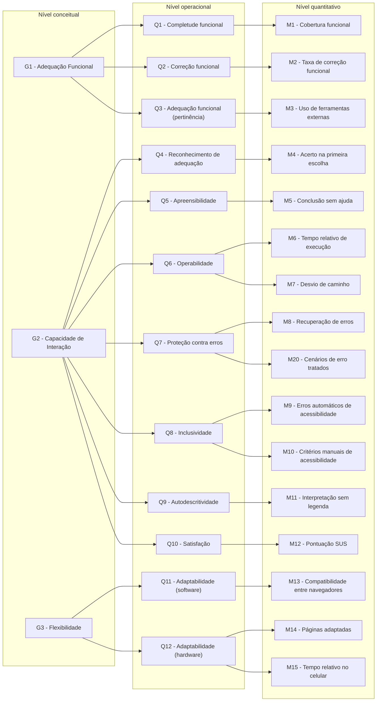
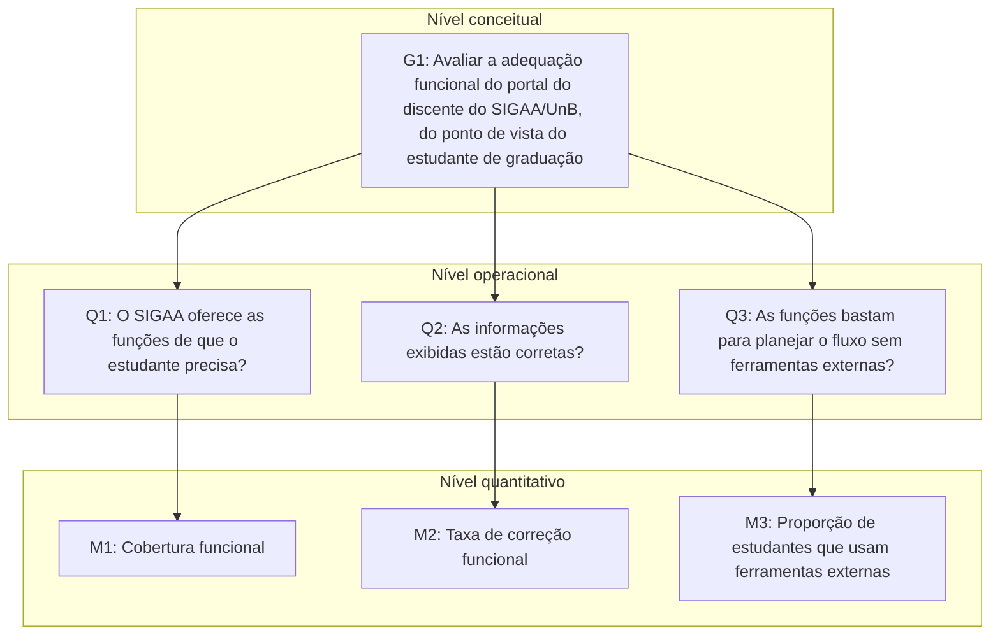
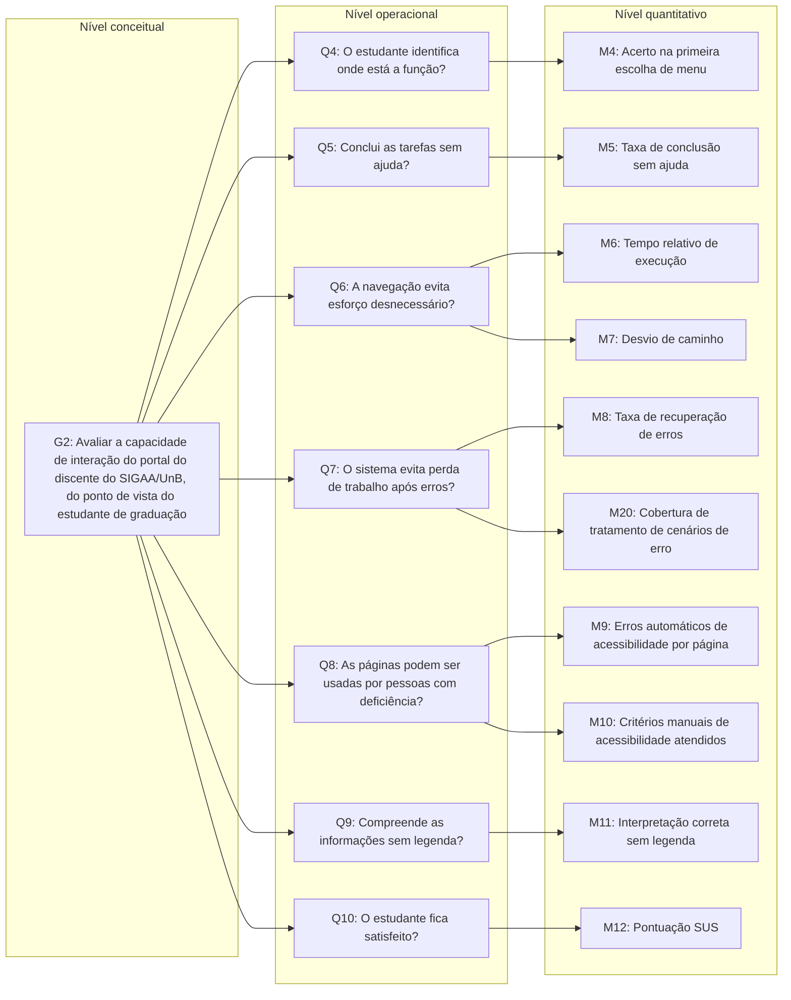
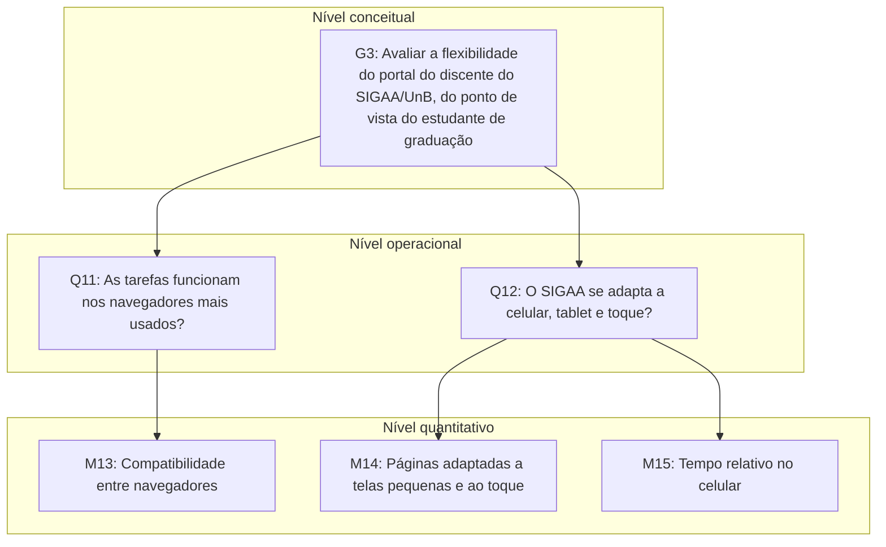

# Gráfico GQM

Os diagramas abaixo representam a hierarquia GQM da avaliação, desdobrando cada objetivo (nível conceitual) em questões (nível operacional) e cada questão em métricas (nível quantitativo). Na visão geral (Figura 1), cada coluna corresponde a um nível do GQM; as Figuras 2 a 4 detalham cada objetivo.

As definições completas estão nas páginas [Objetivos](objetivos.md), [Questões](questoes.md) e [Métricas](metricas.md).

## Visão geral

*Figura 1 - Hierarquia GQM da avaliação (visão geral). Fonte: gerado pelo Claude e revisado por Felipe Campêlo (2026); M20 acrescentada por Leonardo Bonetti (2026).*

## G1 - Adequação Funcional

*Figura 2 - Hierarquia GQM do objetivo G1 - Adequação Funcional. Fonte: gerado pelo Claude e revisado por Felipe Campêlo (2026).*

## G2 - Capacidade de Interação (Usabilidade)

*Figura 3 - Hierarquia GQM do objetivo G2 - Capacidade de Interação. Fonte: gerado pelo Claude e revisado por Felipe Campêlo (2026); M20 acrescentada por Leonardo Bonetti (2026).*

## G3 - Flexibilidade (Portabilidade)

*Figura 4 - Hierarquia GQM do objetivo G3 - Flexibilidade. Fonte: gerado pelo Claude e revisado por Felipe Campêlo (2026).*

A métrica auxiliar MA1 não aparece nas figuras porque não responde a uma questão: ela serve apenas para verificar a hipótese de relação HR2 (Tabela 1).

## Matriz de rastreabilidade

A Tabela 1 liga cada característica priorizada na Fase 1 ao objetivo, às questões, às hipóteses e às métricas desta fase. A prioridade indicada é a da [matriz Impacto x Risco](../fase-1/caracteristicas.md#3-caracteristicas-selecionadas).

*Tabela 1 - Rastreabilidade entre característica da Fase 1, objetivo, questão, hipótese e métrica.*

| Característica (Fase 1) | Objetivo | Questão | Hipótese | Métricas |
| ----------------------- | :------: | :-----: | :------: | -------- |
| Adequação Funcional (prioridade 2) | G1 | Q1 | H1 | M1 |
| | | Q2 | H2 | M2 |
| | | Q3 | H3 | M3 |
| Capacidade de Interação (prioridade 1) | G2 | Q4 | H4 | M4 |
| | | Q5 | H5 | M5 |
| | | Q6 | H6 | M6, M7 |
| | | Q7 | H7 | M8, M20 |
| | | Q8 | H8 | M9, M10 |
| | | Q9 | H9 | M11 |
| | | Q10 | H10 | M12 |
| Flexibilidade (prioridade 4) | G3 | Q11 | H11 | M13 |
| | | Q12 | H12 | M14, M15 |
| Relações entre as características | - | - | HR1 e HR2 | M5, M6, M14 e M15; métrica auxiliar MA1 |

Todas as métricas com nível de pontuação estão ligadas a uma única questão, e todas as questões estão ligadas a um objetivo; não há métrica sem questão nem questão sem métrica ou sem hipótese.

## Histórico de Versão

| Versão | Data | Descrição | Autor |
| :----: | :--: | :-------: | :---: |
| 1.0 | 16/10/2026 | Criação do documento | Davi Nobre |
| 1.1 | 17/10/2026 | Diagramas GQM geral e por objetivo | Felipe Campêlo |
| 1.2 | 18/10/2026 | Numeração e legendas das figuras; nomes das métricas; níveis GQM nas Figuras 2 a 4 | Felipe Campêlo |
| 2.0 | 18/10/2026 | Alinhamento à Fase 1 reestruturada: objetivo G4, questões Q1 a Q14, métricas M1 a M19 e legendas no padrão da Fase 1 | Felipe Campêlo |
| 2.1 | 18/10/2026 | Integração da versão complementar: métrica M20 nas Figuras 1 e 3, nota sobre a métrica auxiliar MA1 e matriz de rastreabilidade Característica, Objetivo, Questão, Hipótese e Métrica | Leonardo Bonetti |
| 2.2 | 25/10/2026 | Remoção do objetivo G4 (Eficiência de Desempenho) da Figura 1, da Figura 5 e da matriz de rastreabilidade, por orientação da professora no ponto de controle; MA1 ligada à HR2 (antiga HR3) | Leonardo Bonetti |
