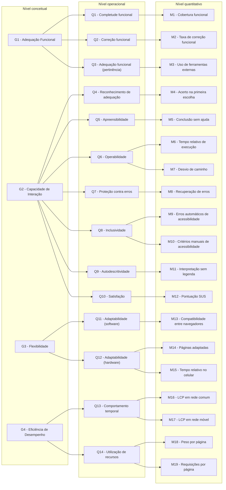
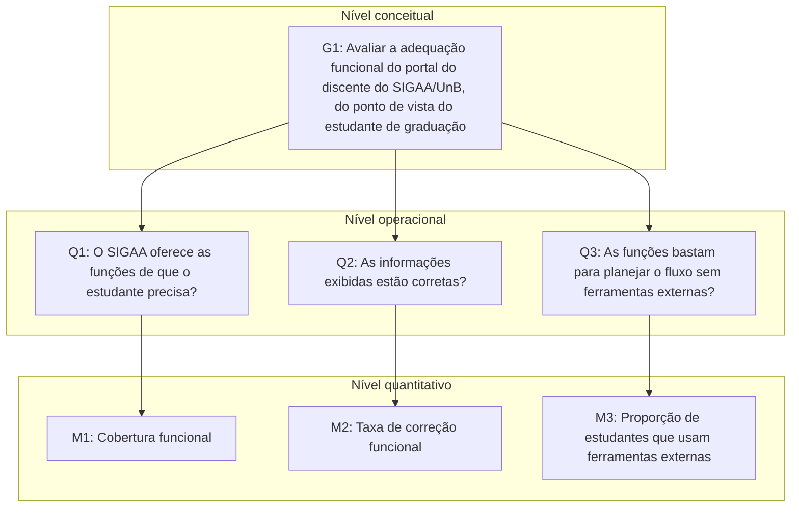
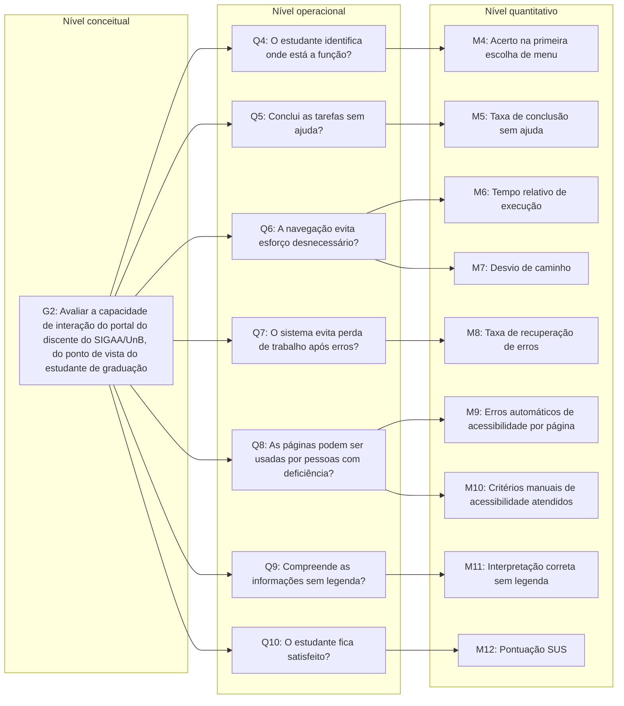
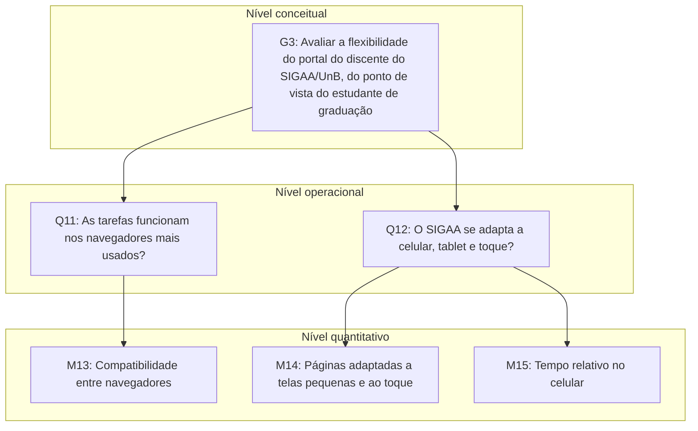
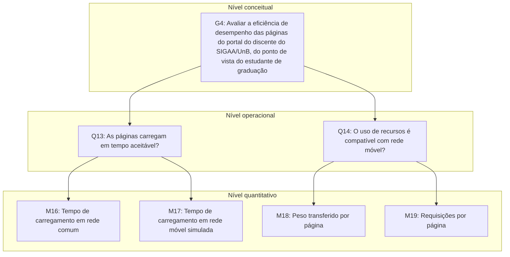

# Gráfico GQM

Os diagramas abaixo representam a hierarquia GQM da avaliação, desdobrando cada objetivo (nível conceitual) em questões (nível operacional) e cada questão em métricas (nível quantitativo). Na visão geral (Figura 1), cada coluna corresponde a um nível do GQM; as Figuras 2 a 5 detalham cada objetivo.

As definições completas estão nas páginas [Objetivos](objetivos.md), [Questões](questoes.md) e [Métricas](metricas.md).

## Visão geral

*Figura 1 - Hierarquia GQM da avaliação (visão geral). Fonte: gerado pelo Claude e revisado por Felipe Campêlo (2026).*

## G1 - Adequação Funcional

*Figura 2 - Hierarquia GQM do objetivo G1 - Adequação Funcional. Fonte: gerado pelo Claude e revisado por Felipe Campêlo (2026).*

## G2 - Capacidade de Interação (Usabilidade)

*Figura 3 - Hierarquia GQM do objetivo G2 - Capacidade de Interação. Fonte: gerado pelo Claude e revisado por Felipe Campêlo (2026).*

## G3 - Flexibilidade (Portabilidade)

*Figura 4 - Hierarquia GQM do objetivo G3 - Flexibilidade. Fonte: gerado pelo Claude e revisado por Felipe Campêlo (2026).*

## G4 - Eficiência de Desempenho

*Figura 5 - Hierarquia GQM do objetivo G4 - Eficiência de Desempenho. Fonte: gerado pelo Claude e revisado por Felipe Campêlo (2026).*

## Histórico de Versão

| Versão | Data | Descrição | Autor |
| :----: | :--: | :-------: | :---: |
| 1.0 | 16/10/2026 | Criação do documento | Davi Nobre |
| 1.1 | 17/10/2026 | Diagramas GQM geral e por objetivo | Felipe Campêlo |
| 1.2 | 18/10/2026 | Numeração e legendas das figuras; nomes das métricas; níveis GQM nas Figuras 2 a 4 | Felipe Campêlo |
| 2.0 | 18/10/2026 | Alinhamento à Fase 1 reestruturada: objetivo G4, questões Q1 a Q14, métricas M1 a M19 e legendas no padrão da Fase 1 | Felipe Campêlo |
