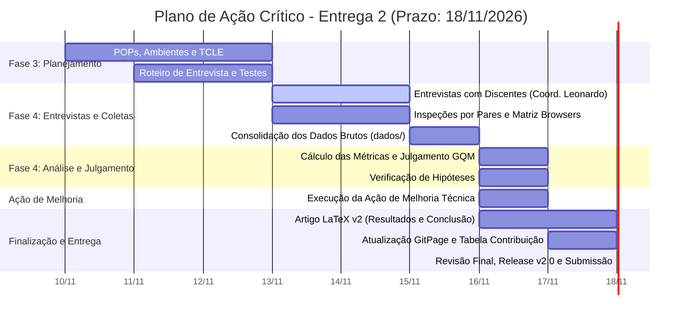

# Cronograma da Avaliação e Plano de Ação da Entrega 2

<!-- Critério F3-C3: O cronograma é realista e alinha as ações à execução da Fase 4. -->
<!-- Critério F3-C8: Consistência entre as Fases 2 e 3 (rastreabilidade total e justificada). -->
<!-- Prazo Fatal da Entrega 2: 18/11/2026. Coordenação das Entrevistas/Validações: Leonardo Fachinello Bonetti. -->

Este documento estabelece o **cronograma operacional intensivo da Entrega 2**, cujo prazo improrrogável de submissão é **18/11/2026**. Ele organiza as ações das **Fases 3 (Projeto da Avaliação)** e **4 (Execução e Julgamento)** da norma **ISO/IEC 25040**, a condução das **entrevistas e testes de validação com discentes de diferentes semestres** (coordenadas por **Leonardo Fachinello Bonetti**), o planejamento da **Ação de Melhoria Técnica Obrigatória**, a **2ª versão do Artigo Científico em LaTeX** e o fechamento da **Gestão do Projeto (PSM/CID)**.

---

## 1. Janela Operacional e Marcos Críticos (Até 18/11/2026)

Com a Entrega 2 fixada para **18/11/2026**, as atividades estão organizadas em uma escala diária de execução:

*Figura 1 — Linha do tempo intensiva da Entrega 2 com prazo fatal em 18/11/2026. Fonte: elaboração da equipe.*

---

## 2. Entrevistas e Testes de Validação com Estudantes

A validação com usuários reais do SIGAA/UnB é realizada por meio de **entrevistas e testes de usabilidade presenciais e remotos**, sob a coordenação geral de **Leonardo Fachinello Bonetti**.

As sessões contemplam estudantes de diferentes momentos acadêmicos da UnB para cobrir a diversidade de perfis definida na Fase 1, avaliando as tarefas **T1 a T6**:

1. **Grupo Calouros (1º e 2º semestres):** foco em apreensibilidade, compreensão da terminologia institucional (IRA, menções) e leitura do código de horários.
2. **Grupo Intermediários (3º ao 6º semestres):** foco em fluxo de disciplinas, regras de pré-requisitos e uso da Turma Virtual.
3. **Grupo Veteranos / Formandos (7º semestre em diante):** foco em verificação de integralização curricular, carga horária pendente e emissão de documentos.
4. **Recorte Transversal (Uso em Celular):** validação da interface em smartphones (Android/iOS) sob controle por toque.

*Tabela 1 — Planejamento das Entrevistas e Testes de Validação (Coordenação: Leonardo Fachinello Bonetti).*

| Perfil de Estudante | Quantidade Mínima | Tarefas Avaliadas | Período de Realização | Instrumentos e Registro | Responsável pela Condução |
| :--- | :---: | :---: | :---: | :--- | :--- |
| **Calouros**  | 1 a 2 discentes | T1, T2, T5, T6 | 13/11/2026 a 15/11/2026 | Roteiro estruturado, gravação consentida (TCLE) | Caio Borges |
| **Intermediários**  | 1 discente | T1, T2, T4, T5 | 13/11/2026 a 15/11/2026 | Roteiro estruturado, gravação consentida (TCLE) | Daniel Duarte / Caio Borges |
| **Formandos** (7º sem. em diante) | 1 a 2 discentes | T2, T3, T4 | 14/11/2026 a 15/11/2026 | Roteiro estruturado, gravação consentida (TCLE) | Leonardo Bonetti / Davi Nobre |

---

## 3. Matriz de Tarefas da Entrega 2 (Programado vs. Efetivamente Feito)

A Tabela 2 apresenta as atividades com prazos diários calibrados para o fechamento em **18/11/2026**, servindo de base para auditar o **programado contra o efetivamente executado**.

*Tabela 2 — Cronograma operacional detalhado para a Entrega 2 (Prazo final: 18/11/2026).*

| ID | Pacote / Atividade | Responsável | Início | Fim Plan. | Esforço (h) | Status | Fim Real | Esforço Real | Desvio / Observações |
| :---: | :--- | :--- | :---: | :---: | :---: | :---: | :---: | :---: | :--- |
| **E2-F3** | **Fase 3 — Projeto da Avaliação** | | | | | | | | |
| T01 | Formalização do Cronograma da E2 (Prazo 18/11) | Davi Nobre | 10/11/2026 | 12/11/2026 | 3,0 h | **Concluído** | 12/11/2026 | — | Alinhado à data fatal de 18/11/2026 |
| T02 | Elaboração dos POPs e Métodos de Coleta (F3-C1) | Leonardo Bonetti | 11/11/2026 | 13/11/2026 | 4,0 h | Em andamento | — | — | Instruções de repetibilidade |
| T03 | Especificação de Ambientes, Telas e Dados (F3-C2) | Davi Nobre | 11/11/2026 | 13/11/2026 | 3,0 h | Em andamento | — | — | Matriz mobile e desktop |
| T04 | Roteiro do Moderador e TCLE para Entrevistas | Daniel Duarte | 11/11/2026 | 13/11/2026 | 4,0 h | Em andamento | — | — | Guia de aplicação das entrevistas |
| T05 | Matriz de Rastreabilidade Fase 2 → Fase 3 (F3-C8) | Leonardo Bonetti | 12/11/2026 | 14/11/2026 | 2,5 h | Planejado | — | — | Coerência com métricas e níveis |
| **E2-F4A** | **Fase 4 — Entrevistas e Coleta de Dados Brutos** | | | | | | | | |
| T06 | **Coordenação e Condução das Entrevistas** | **Leonardo Bonetti** | 13/11/2026 | 15/11/2026 | 10,0 h | Planejado | — | — | **Coordenação de Leonardo Bonetti; condução conjunta com a equipe (Caio, Daniel, Davi) conforme Tabela 1** |
| T07 | Execução das Inspeções por Pares (M1, M2, M10, M20) | Daniel / Davi | 13/11/2026 | 15/11/2026 | 6,0 h | Planejado | — | — | 2 avaliadores independentes |
| T08 | Testes em Matriz de Browsers e Telas (M13 a M15) | Felipe Campêlo | 13/11/2026 | 15/11/2026 | 5,0 h | Planejado | — | — | Desktop, tablet e smartphone |
| T09 | Organização e Anonimização dos Dados Brutos (`dados/`) | Caio Borges | 15/11/2026 | 16/11/2026 | 4,0 h | Planejado | — | — | Planilhas, notas e gravações (F4-C2) |
| **E2-F4B** | **Fase 4 — Análise, Julgamento e Hipóteses** | | | | | | | | |
| T10 | Tabulação e Cálculo Estatístico das Métricas | Leonardo Bonetti | 16/11/2026 | 17/11/2026 | 5,0 h | Planejado | — | — | Métricas M1 a M15 e M20 (F4-C3) |
| T11 | Confronto com Níveis de Pontuação e Julgamento | Daniel Duarte | 16/11/2026 | 16/11/2026 | 4,0 h | Planejado | — | — | Julgamento por objetivo (G1, G2, G3) |
| T12 | Verificação de Hipóteses (H1 a H12, HR1, HR2) | Felipe Campêlo | 16/11/2026 | 17/11/2026 | 3,5 h | Planejado | — | — | Confirmadas, refutadas ou inconclusivas |
| T13 | Análise de Coerência com o Propósito da Fase 1 | Caio Borges | 16/11/2026 | 17/11/2026 | 3,0 h | Planejado | — | — | Resposta às decisões apoiadas (F4-C4) |
| **E2-MEL** | **Ação de Melhoria Técnica Obrigatória** | | | | | | | | |
| T14 | Seleção da oportunidade crítica pós-julgamento | Toda a equipe | 16/11/2026 | 16/11/2026 | 2,5 h | Planejado | — | — | Baseada no pior resultado da Fase 4 |
| T15 | Execução Técnica da Ação de Melhoria | Davi / Arthur | 16/11/2026 | 17/11/2026 | 8,0 h | Planejado | — | — | Formato a definir conforme resultado (extensão/userscript/protótipo) |
| T16 | Documentação técnica e justificativa da melhoria | Daniel Duarte | 17/11/2026 | 17/11/2026 | 3,5 h | Planejado | — | — | Rastreabilidade evidência → melhoria |
| **E2-ART** | **Artigo Científico v2, GitPage e Release** | | | | | | | | |
| T17 | Redação de Resultados e Discussão no Artigo IEEE | Leonardo / Caio | 16/11/2026 | 17/11/2026 | 6,0 h | Planejado | — | — | Inserção de dados, gráficos e tabelas |
| T18 | Redação da Ação de Melhoria e Conclusão no Artigo | Arthur Leite | 17/11/2026 | 18/11/2026 | 4,0 h | Planejado | — | — | Fechamento do texto (máx. 15 páginas) |
| T19 | Atualização da GitPage com Fases 3 e 4 completas | Davi Nobre | 16/11/2026 | 18/11/2026 | 5,0 h | Planejado | — | — | Páginas da F3 e F4 no MkDocs |
| T20 | Apêndice de Contribuição Individual (total 100%) | Felipe Campêlo | 17/11/2026 | 18/11/2026 | 2,5 h | Planejado | — | — | Horas consolidadas via script/planilha |
| T21 | Revisão Final e Compilação do Artigo em LaTeX | Toda a equipe | 18/11/2026 | 18/11/2026 | 3,0 h | Planejado | — | — | Formatação e referências IEEE |
| T22 | **Publicação da Release v2.0 e Submissão Moodle** | Davi Nobre | 18/11/2026 | **18/11/2026** | 2,0 h | Planejado | — | — | **Entrega oficial no Moodle** |

*Fonte: elaboração da equipe (2026). Nota: Os valores da coluna "Esforço Real" são consolidados a partir das medições automáticas do GitHub Actions (word-diff em PRs) e dos apontamentos de atividades extracódigo em `gestao/esforco.csv` (como entrevistas e reuniões).*

---

## 4. Ação de Melhoria Obrigatória (Critério de Seleção)

Conforme a seção 3.2 do roteiro da disciplina, a equipe deve executar obrigatoriamente pelo menos uma ação de melhoria técnica, justificada com base nas evidências obtidas na Fase 4.

A equipe avaliará os resultados da avaliação no dia **16/11/2026** para deliberar entre as quatro opções previstas pelo roteiro:

1. **Elaboração de protótipo:** caso o problema crítico se concentre na interface, usabilidade ou fluxo de navegação do discente.
2. **Modificação direta de código ou extensão técnica:** caso o problema seja passível de correção direta em código client-side ou script auxiliar (por exemplo, extensão de navegador ou userscript), sem necessidade de acesso ao código-fonte do SIGAA.
3. **Templates técnicos:** caso o problema seja ausência ou fragilidade de documentação/padronização.
4. **Proposição de processo:** caso seja identificado um vício de processo recorrente.

O grupo Adele Goldstine não possui acesso ao código-fonte fechado do SIGAA. Dessa forma, ficam descartadas quaisquer opções que dependam de modificação direta nos servidores ou no repositório interno do sistema. Contudo, soluções que atuem exclusivamente no lado do cliente, como extensões de navegador ou userscripts, permanecem viáveis, uma vez que não requerem acesso ao código-fonte da aplicação.

---

## 5. Rastreabilidade com os Indicadores PSM/CID

A validação do **programado vs. efetivamente feito** é aferida diariamente até o dia **18/11/2026**:

1. **I1 (% Concluído):** medido pela razão de tarefas concluídas sobre as 22 planejadas na Tabela 2.
   - Meta em 13/11/2026: ≈ 18% (T01 a T04 concluídas — planejamento da Fase 3 fechado).
   - Meta em 15/11/2026: ≈ 41% (T01 a T09 — entrevistas e coletas concluídas).
   - Meta em 17/11/2026: ≈ 82% (T01 a T18 — análises, melhoria e rascunho do artigo concluídos).
   - Meta em 18/11/2026: 100% (Release v2.0 e submissão no Moodle).
2. **I2 (Burndown de Issues):** as atividades correspondem a *issues* no milestone **Entrega 2** do repositório, com fechamento diário por PRs.
3. **I3 (Esforço por Membro):** monitorado pela estimativa automática de horas via GitHub Actions (word-diff em PRs) e complementado por registros manuais na planilha `gestao/esforco.csv` para atividades fora do Git (entrevistas, inspeções presenciais e reuniões), conforme metodologia descrita na [página de Contribuição](../contribuicao.md).

---

## Histórico de Versão

| Versão | Data | Descrição | Autor |
| :----: | :--: | :-------: | :---: |
| 1.0 | 12/11/2026 | Criação do cronograma detalhado da Entrega 2 alinhado à data fatal de 18/11/2026 e com foco nas entrevistas coordenadas por Leonardo Fachinello Bonetti | [Davi Nobre](https://github.com/Jagaima) |
| 1.1 | 12/11/2026 | Remoção do questionário online, formatação de todas as datas no padrão brasileiro (DD/MM/AAAA) e flexibilização da ação de melhoria técnica | [Davi Nobre](https://github.com/Jagaima) |
| 1.2 | 12/11/2026 | Correções da revisão de PR: dateFormat do Gantt, alinhamento de datas entre tabelas, metas do I1, escopo da exclusão de melhorias, descrição do I3 e parágrafo da seção 4 | [Davi Nobre](https://github.com/Jagaima) |
