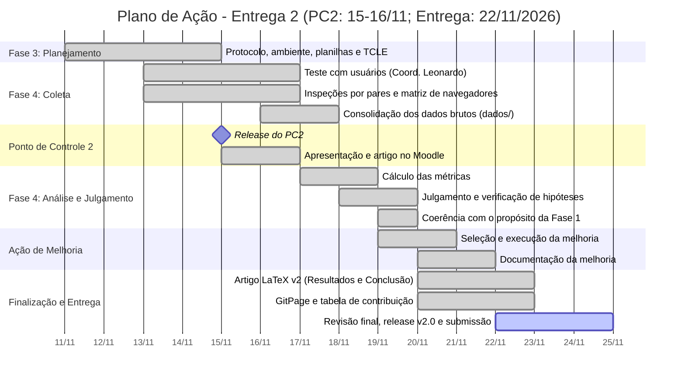

# Cronograma da Avaliação e Plano de Ação da Entrega 2

<!-- Critério F3-C3: O cronograma é realista e alinha as ações à execução da Fase 4. -->
<!-- Critério F3-C8: Consistência entre as Fases 2 e 3 (rastreabilidade total e justificada). -->
<!-- Entrega 2: 22/11/2026. Ponto de Controle 2 (PC2): release até 15/11/2026, 23h59; apresentação em 16/11/2026. Coordenação das entrevistas: Leonardo Fachinello Bonetti. -->

Este documento estabelece o **cronograma operacional da Entrega 2**, cujo prazo de submissão é **22/11/2026**, com o **Ponto de Controle 2 (PC2)** no meio do caminho: release do PC2 no repositório até **15/11/2026, às 23h59**, e apresentação à professora em **16/11/2026**. Ele organiza as ações das **Fases 3 (Projeto da Avaliação)** e **4 (Execução e Julgamento)** da norma **ISO/IEC 25040**, a condução do **teste com usuários com estudantes do começo e do meio ou fim do curso** (coordenado por **Leonardo Fachinello Bonetti**), o planejamento da **Ação de Melhoria Técnica Obrigatória**, a **2ª versão do Artigo Científico em LaTeX** e o fechamento da **Gestão do Projeto (PSM/CID)**.

---

## 1. Janela Operacional e Marcos Críticos (Até 22/11/2026)

Com o PC2 em 15 e 16/11/2026 e a Entrega 2 em **22/11/2026**, as atividades estão organizadas em uma escala diária de execução:

*Figura 1 — Linha do tempo da Entrega 2, com o PC2 em 15 e 16/11/2026 e a entrega em 22/11/2026. Fonte: elaboração da equipe.*

---

## 2. Teste com Usuários

O teste com usuários segue o [Protocolo do Teste com Usuários](teste-usuarios.md), sob a coordenação geral de **Leonardo Fachinello Bonetti**. São **6 participantes**, em dois grupos de três que diferem apenas no semestre, e **todos executam as tarefas T1 a T6** na mesma sessão, na ordem rotacionada do protocolo. Ao fim de cada sessão, o participante responde o SUS e o [questionário](../fase-2/questionario.md):

1. **Começo do curso (1º e 2º semestres):** perfil calouro da Fase 1, com atenção à apreensibilidade e à compreensão da terminologia institucional (IRA, menções, código de horário).
2. **Meio ou fim do curso (5º semestre em diante):** perfis veterano e formando, com atenção à integralização curricular, à carga horária pendente e à emissão de documentos.

Estudantes do 3º e do 4º semestre não são recrutados. O uso no celular não faz parte das sessões: é avaliado por inspeção da equipe nas métricas M14 e M15 (T08).

*Tabela 1 — Planejamento do teste com usuários (Coordenação: Leonardo Fachinello Bonetti).*

| Grupo | Participantes | Tarefas | Período de Realização | Instrumentos e Registro | Responsável pela Condução |
| :--- | :---: | :---: | :---: | :--- | :--- |
| **Começo do curso** (1º e 2º semestres) | 3, mais 1 reserva | T1 a T6 | 13/11/2026 a 16/11/2026 | Roteiro do protocolo, gravação consentida (TCLE), SUS e questionário | Caio Borges / Daniel Duarte |
| **Meio ou fim do curso** (5º semestre em diante) | 3, mais 1 reserva | T1 a T6 | 13/11/2026 a 16/11/2026 | Roteiro do protocolo, gravação consentida (TCLE), SUS e questionário | Leonardo Bonetti / Davi Nobre |

---

## 3. Matriz de Tarefas da Entrega 2 (Programado vs. Efetivamente Feito)

A Tabela 2 apresenta as atividades com prazos diários até a entrega em **22/11/2026**, incluindo as entregas do PC2 (pacote E2-PC2), e serve de base para auditar o **programado contra o efetivamente executado**.

*Tabela 2 — Cronograma operacional detalhado para a Entrega 2 (PC2: 15 e 16/11/2026; prazo final: 22/11/2026).*

| ID | Pacote / Atividade | Responsável | Início | Fim Plan. | Esforço (h) | Status | Fim Real | Esforço Real | Desvio / Observações |
| :---: | :--- | :--- | :---: | :---: | :---: | :---: | :---: | :---: | :--- |
| **E2-F3** | **Fase 3 — Projeto da Avaliação** | | | | | | | | |
| T01 | Formalização do Cronograma da E2 | Davi Nobre | 10/11/2026 | 12/11/2026 | 3,0 h | **Concluído** | 12/11/2026 | — | Prazo revisto em 14/11/2026: PC2 em 15 e 16/11 e entrega em 22/11 (v1.3) |
| T02 | Elaboração dos POPs e Métodos de Coleta (F3-C1) | Leonardo Bonetti | 11/11/2026 | 13/11/2026 | 4,0 h | **Concluído** | 14/11/2026 | — | [Protocolo do Teste com Usuários](teste-usuarios.md) e [Planilhas de Coleta](planilhas.md) (PR #14); 1 dia de atraso |
| T03 | Especificação de Ambientes, Telas e Dados (F3-C2) | Davi Nobre | 11/11/2026 | 13/11/2026 | 3,0 h | **Concluído** | 14/11/2026 | — | [Recursos e Ambiente](recursos-ambiente.md) (PR #13), executada por Felipe Campêlo; 1 dia de atraso |
| T04 | Roteiro do Moderador e TCLE para Entrevistas | Daniel Duarte | 11/11/2026 | 13/11/2026 | 4,0 h | **Concluído** | 14/11/2026 | — | Roteiro da sessão e termo de consentimento (PR #14), executada por Leonardo Bonetti; 1 dia de atraso |
| T05 | Matriz de Rastreabilidade Fase 2 → Fase 3 (F3-C8) | Leonardo Bonetti | 12/11/2026 | 14/11/2026 | 2,5 h | **Concluído** | 14/11/2026 | — | Tabelas 2 e 3 da [página da Fase 3](index.md) (PR #14) |
| **E2-F4A** | **Fase 4 — Teste com Usuários e Coleta de Dados Brutos** | | | | | | | | |
| T06 | **Coordenação e Condução do Teste com Usuários** | **Leonardo Bonetti** | 13/11/2026 | 16/11/2026 | 10,0 h | **Concluído** | 16/11/2026 | — | Sessões P1 e P3 em 15/11 (Caio e Felipe) e P2, P4 e P6 em 16/11 (Leonardo), com auxílio de Daniel; PRs #16, #18 e #20. P5 não aconteceu: coleta encerrada com 5 participantes em 21/11 |
| T07 | Execução das Inspeções por Pares (M1, M2, M10, M20) | Daniel / Davi | 13/11/2026 | 16/11/2026 | 6,0 h | **Concluído** | 22/11/2026 | — | Executada por Caio Borges: *script* como primeiro avaliador e Caio como segundo (PR #24); 6 dias de atraso |
| T08 | Testes em Matriz de Navegadores e Telas (M13 a M15) | Felipe Campêlo | 13/11/2026 | 16/11/2026 | 5,0 h | **Concluído** | 22/11/2026 | — | M13 e M14 instrumentados por Arthur (PR #19), Edge e WebKit em M13 por Felipe (PR #22) e M15 no celular por Leonardo (PR #24); 6 dias de atraso |
| T09 | Organização e Anonimização dos Dados Brutos (`dados/`) | Caio Borges | 16/11/2026 | 17/11/2026 | 4,0 h | **Concluído** | 21/11/2026 | — | Dados das sessões por Caio, Felipe e Leonardo (PRs #16, #18 e #20) e análise das gravações por Caio (PR #20); 4 dias de atraso |
| **E2-PC2** | **Ponto de Controle 2** | | | | | | | | |
| P01 | Release do PC2 no repositório | Davi Nobre | 15/11/2026 | 15/11/2026 | 0,5 h | **Concluído** | 16/11/2026 | — | Tag `Entrega2` às 00h04 de 16/11, depois do PR #19 de Arthur; 5 minutos após o prazo |
| P02 | Apresentação do PC2 (PDF no Moodle) | Toda a equipe | 15/11/2026 | 16/11/2026 | 4,0 h | **Concluído** | 16/11/2026 | — | Apresentada em 16/11 |
| P03 | Artigo no estágio atual no Moodle | Arthur Leite | 16/11/2026 | 16/11/2026 | 1,0 h | **Concluído** | 16/11/2026 | — | Artigo do PC2 (PR #19) |
| **E2-F4B** | **Fase 4 — Análise, Julgamento e Hipóteses** | | | | | | | | |
| T10 | Tabulação e Cálculo das Métricas | Leonardo Bonetti | 17/11/2026 | 18/11/2026 | 5,0 h | **Concluído** | 22/11/2026 | — | Primeiro cálculo do teste por Leonardo (18/11) e regras, gravações e indicadores por Caio (PR #20); M13 e M9 por Felipe (PR #22); inspeção e M15 no PR #24; 4 dias de atraso |
| T11 | Confronto com Níveis de Pontuação e Julgamento | Daniel Duarte | 18/11/2026 | 19/11/2026 | 4,0 h | **Concluído** | 22/11/2026 | — | Executada por Leonardo Bonetti e completada por Caio com a inspeção (PR #24); 3 dias de atraso |
| T12 | Verificação de Hipóteses (H1 a H16, HR1, HR2) | Felipe Campêlo | 18/11/2026 | 19/11/2026 | 3,5 h | **Concluído** | 23/11/2026 | — | Executada por Leonardo Bonetti (PR #24); H5 reclassificada como refutada por Caio em 23/11 (PR #26); 4 dias de atraso |
| T13 | Análise de Coerência com o Propósito da Fase 1 | Caio Borges | 19/11/2026 | 19/11/2026 | 3,0 h | **Concluído** | 22/11/2026 | — | Executada por Leonardo Bonetti (PR #24); 3 dias de atraso |
| **E2-MEL** | **Ação de Melhoria Técnica Obrigatória** | | | | | | | | |
| T14 | Seleção da oportunidade crítica pós-julgamento | Toda a equipe | 19/11/2026 | 19/11/2026 | 2,5 h | **Concluído** | 22/11/2026 | — | Protótipo de alta fidelidade, por não haver acesso ao código do SIGAA (PR #23); 3 dias de atraso |
| T15 | Execução Técnica da Ação de Melhoria | Davi / Arthur | 19/11/2026 | 20/11/2026 | 8,0 h | **Concluído** | 23/11/2026 | — | Protótipo *mobile* de Davi (PR #23), medido e ajustado por Caio: M14 12 de 12 e M9 0 erros (PR #25); 3 dias de atraso |
| T16 | Documentação técnica e justificativa da melhoria | Daniel Duarte | 20/11/2026 | 21/11/2026 | 3,5 h | **Concluído** | 23/11/2026 | — | [Protótipo mobile](../fase-4/prototipo-mobile.md) por Davi (PR #23) e Caio (PR #25); 2 dias de atraso |
| **E2-ART** | **Artigo Científico v2, GitPage e Release** | | | | | | | | |
| T17 | Redação de Resultados e Discussão no Artigo IEEE | Leonardo / Caio | 20/11/2026 | 21/11/2026 | 6,0 h | **Concluído** | 23/11/2026 | — | Executada por Arthur Leite (PR #26); 2 dias de atraso |
| T18 | Redação da Ação de Melhoria e Conclusão no Artigo | Arthur Leite | 21/11/2026 | 22/11/2026 | 4,0 h | **Concluído** | 23/11/2026 | — | PR #26 (12 páginas); 1 dia de atraso |
| T19 | Atualização da GitPage com Fases 3 e 4 completas | Davi Nobre | 20/11/2026 | 22/11/2026 | 5,0 h | **Concluído** | 23/11/2026 | — | Páginas da Fase 4 por toda a equipe (PRs #20 a #26); síntese final e matriz multiplataforma por Arthur (PR #26) |
| T20 | Apêndice de Contribuição Individual (total 100%) | Felipe Campêlo | 21/11/2026 | 22/11/2026 | 2,5 h | Cancelado | — | — | Por orientação da professora, o artigo trata só da avaliação: a contribuição fica na [página de Contribuição](../contribuicao.md) e no dashboard (PR #28) |
| T21 | Revisão Final e Compilação do Artigo em LaTeX | Toda a equipe | 22/11/2026 | 22/11/2026 | 3,0 h | Em andamento | — | — | Compilado por Arthur (PR #26), sem revisão de outro membro |
| T22 | **Publicação da Release v2.0 e Submissão Moodle** | Davi Nobre | 22/11/2026 | **22/11/2026** | 2,0 h | Planejado | — | — | **Entrega oficial no Moodle**, com prazo prorrogado para 24/11/2026, 23h59 |

*Fonte: elaboração da equipe (2026). Nota: Os valores da coluna "Esforço Real" são consolidados a partir das medições automáticas do GitHub Actions (word-diff em PRs) e dos apontamentos de atividades extracódigo em `gestao/esforco.csv` (como entrevistas e reuniões). As tarefas do PC2 usam o prefixo P para não renumerar as tarefas T10 a T22, já citadas pela equipe.*

---

## 4. Ação de Melhoria Obrigatória (Critério de Seleção)

Conforme a seção 3.2 do roteiro da disciplina, a equipe deve executar obrigatoriamente pelo menos uma ação de melhoria técnica, justificada com base nas evidências obtidas na Fase 4.

A equipe avaliará os resultados da avaliação no dia **19/11/2026** (T14), depois do julgamento, para deliberar entre as quatro opções previstas pelo roteiro:

1. **Elaboração de protótipo:** caso o problema crítico se concentre na interface, usabilidade ou fluxo de navegação do discente.
2. **Modificação direta de código ou extensão técnica:** caso o problema seja passível de correção direta em código client-side ou script auxiliar (por exemplo, extensão de navegador ou userscript), sem necessidade de acesso ao código-fonte do SIGAA.
3. **Templates técnicos:** caso o problema seja ausência ou fragilidade de documentação/padronização.
4. **Proposição de processo:** caso seja identificado um vício de processo recorrente.

O grupo Adele Goldstine não possui acesso ao código-fonte fechado do SIGAA. Dessa forma, ficam descartadas quaisquer opções que dependam de modificação direta nos servidores ou no repositório interno do sistema. Contudo, soluções que atuem exclusivamente no lado do cliente, como extensões de navegador ou userscripts, permanecem viáveis, uma vez que não requerem acesso ao código-fonte da aplicação.

---

## 5. Rastreabilidade com os Indicadores PSM/CID

A validação do **programado vs. efetivamente feito** é aferida diariamente até o dia **22/11/2026**:

1. **I1 (% Concluído):** medido pela razão de tarefas concluídas sobre as 25 planejadas na Tabela 2 (T01 a T22 e P01 a P03). As metas contam as tarefas cujo fim planejado é até a data.
   - Meta em 15/11/2026: 24% (T01 a T05 e P01 — Fase 3 fechada e release do PC2).
   - Meta em 16/11/2026: 44% (mais T06 a T08, P02 e P03 — coleta concluída e PC2 apresentado).
   - Meta em 19/11/2026: 68% (mais T09 a T14 — dados organizados, métricas, julgamento, hipóteses e seleção da melhoria).
   - Meta em 22/11/2026: 100% (Release v2.0 e submissão no Moodle).
   - Resultado em 23/11/2026: 22 de 25 (88%). T20 foi cancelada, T21 está em andamento e T22 vai até 24/11/2026, novo prazo da entrega. Das 22 concluídas, 17 terminaram depois do fim planejado, de 1 a 6 dias, e 13 foram executadas no todo ou em parte por outro membro.
2. **I2 (Burndown de Issues):** ainda não há *milestone* nem *issues* no repositório, então o *burndown* não pode ser medido (lacuna já registrada em [Gestão do Projeto](../gestao-psm.md)). Enquanto a gestão não decidir criá-los, o acompanhamento é feito pelo status da Tabela 2 e pelos PRs.
3. **I3 (Esforço por Membro):** monitorado pela estimativa automática de horas via GitHub Actions (word-diff em PRs) e complementado por registros manuais na planilha `gestao/esforco.csv` para atividades fora do Git (entrevistas, inspeções presenciais e reuniões), conforme metodologia descrita na [página de Contribuição](../contribuicao.md).

---

## Histórico de Versão

| Versão | Data | Descrição | Autor |
| :----: | :--: | :-------: | :---: |
| 1.0 | 12/11/2026 | Criação do cronograma detalhado da Entrega 2 alinhado à data fatal de 18/11/2026 e com foco nas entrevistas coordenadas por Leonardo Fachinello Bonetti | [Davi Nobre](https://github.com/Jagaima) |
| 1.1 | 12/11/2026 | Remoção do questionário online, formatação de todas as datas no padrão brasileiro (DD/MM/AAAA) e flexibilização da ação de melhoria técnica | [Davi Nobre](https://github.com/Jagaima) |
| 1.2 | 12/11/2026 | Correções da revisão de PR: dateFormat do Gantt, alinhamento de datas entre tabelas, metas do I1, escopo da exclusão de melhorias, descrição do I3 e parágrafo da seção 4 | [Davi Nobre](https://github.com/Jagaima) |
| 1.4 | 23/11/2026 | Status, fim real e executores de T06 a T22 e P01 a P03, a partir dos PRs #16 a #28; T20 cancelada; Gantt e resultado do I1 em 23/11/2026 | Caio Borges |
| 1.3 | 14/11/2026 | Entrega em 22/11/2026 e PC2 em 15 e 16/11 (tarefas P01 a P03); teste com usuários alinhado ao protocolo (2 grupos de 3, T1 a T6, até 16/11); datas da análise sem sobreposição; status de T02 a T06; H1 a H16 em T12; metas do I1 recalculadas; I2 sem *milestone*; `inclusiveEndDates` no Gantt | Caio Borges |
