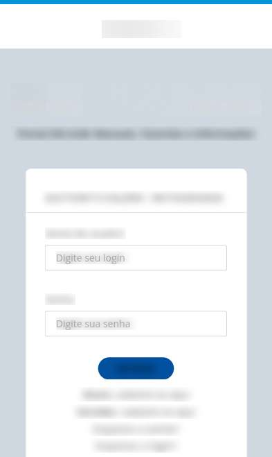
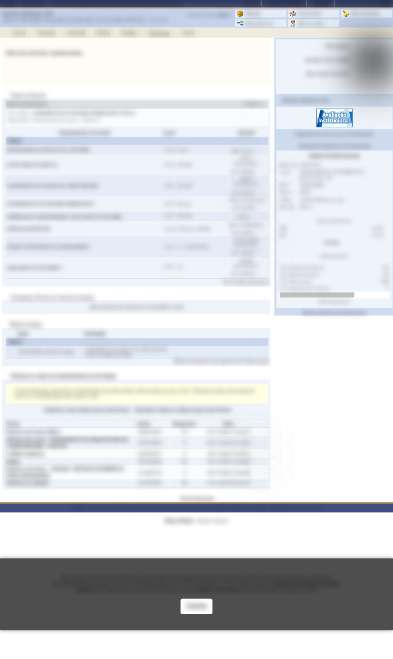
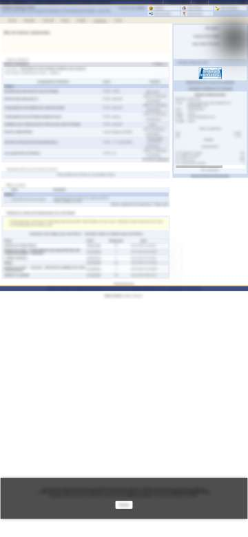
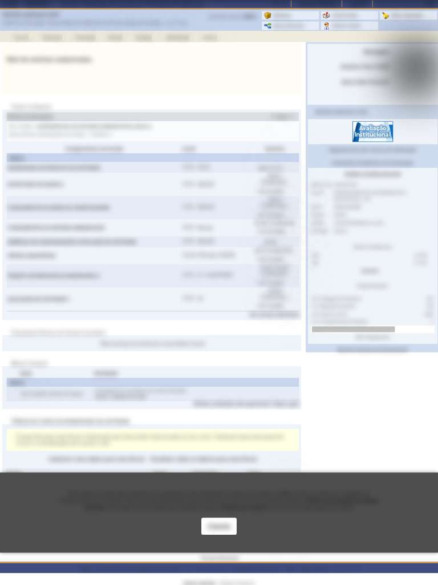
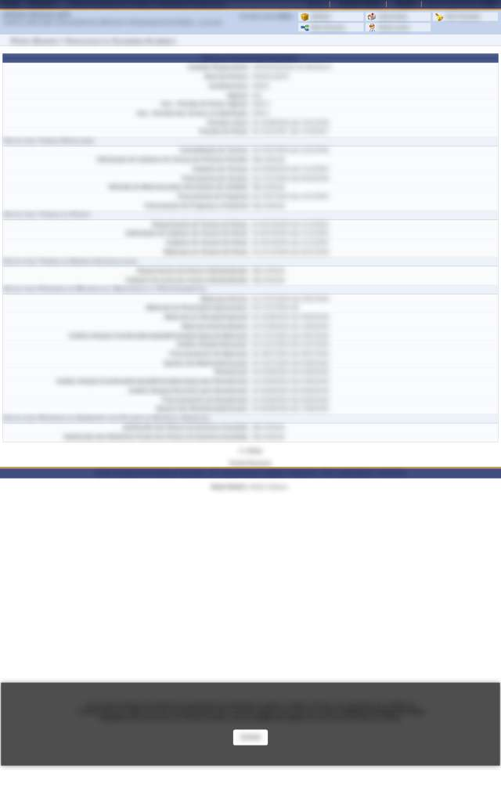
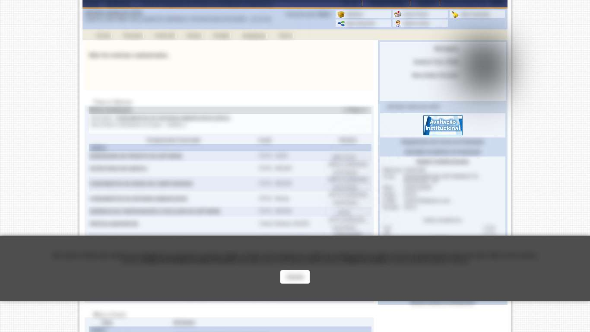

# Matriz Multiplataforma (dado complementar)

<!-- Complemento de G3 - Flexibilidade: amplia M13 e M14 para 20 perfis de sistema, aparelho e navegador. Não altera o julgamento. -->

M13 mediu quatro navegadores de computador, e M14, duas larguras emuladas no Google Chrome (360 e 768 px). Para saber se o resultado de Flexibilidade depende do **sistema operacional**, do **aparelho** ou do **navegador**, a equipe levou os mesmos *scripts* a uma matriz de **20 perfis** e **7 navegadores**: computador com Windows, macOS e Linux; celular com Android e iOS; e tablet com Android e iPadOS. Como a matriz não estava no plano da Fase 3 e usa emulação, ela é **dado complementar**: confirma e generaliza M13 e M14, mas não altera os seus valores nem o julgamento ([Julgamento da Avaliação](julgamento.md)).

## 1. Perfis e navegadores

*Tabela 1 - Os 20 perfis da matriz.*

| Categoria | Sistema | Aparelho (largura CSS) | Navegador | Motor |
| --------- | ------- | ---------------------- | --------- | ----- |
| Computador | Windows 11 | Notebook 1366 × 768 | Google Chrome, Microsoft Edge, Opera, Brave | Blink (Chromium) |
| Computador | Windows 11 | Notebook 1366 × 768 | Mozilla Firefox | Gecko |
| Computador | macOS | MacBook Air 1440 × 900 (densidade 2) | Safari | WebKit |
| Computador | macOS | MacBook Air 1440 × 900 (densidade 2) | Google Chrome | Blink |
| Computador | Linux (Ubuntu) | Monitor 1920 × 1080 | Chromium, Google Chrome | Blink |
| Computador | Linux (Ubuntu) | Monitor 1920 × 1080 | Mozilla Firefox | Gecko |
| Celular | Android 14 | Galaxy S24 (360 px), Pixel 7 (412 px) | Google Chrome | Blink |
| Celular | Android 14 | Galaxy A55 (480 px) | Microsoft Edge | Blink |
| Celular | Android 7 | Moto G4 (360 px), aparelho de entrada | Opera | Blink |
| Celular | iOS 17 e 18 | iPhone SE 3ª geração (375 px), iPhone 15 (393 px), iPhone 15 Pro Max (430 px) | Safari | WebKit |
| Tablet | Android 14 | Galaxy Tab S9 (640 px) | Google Chrome | Blink |
| Tablet | iPadOS | iPad Mini (768 px), iPad Pro 11 (834 px) | Safari | WebKit |

*Fonte: elaboração da equipe; versões exatas na coluna `versao` de [`dados/consolidados/matriz-resumo.csv`](https://github.com/FCTE-Qualidade-de-Software-1/2026-2_T02_ADELE_GOLDSTINE/blob/main/dados/consolidados/matriz-resumo.csv).*

## 2. Método

O *script* [`coleta/matriz_dispositivos.py`](https://github.com/FCTE-Qualidade-de-Software-1/2026-2_T02_ADELE_GOLDSTINE/blob/main/coleta/matriz_dispositivos.py) reaproveita a sessão, as tarefas e as medidas de [`sigaa_coleta.py`](https://github.com/FCTE-Qualidade-de-Software-1/2026-2_T02_ADELE_GOLDSTINE/blob/main/coleta/sigaa_coleta.py), com as mesmas [regras éticas](flexibilidade.md#22-regras-eticas-e-de-protecao-de-dados): só consultas, uma sessão por vez, 3 s entre as tarefas e credenciais só em variáveis de ambiente. Em cada perfil, ele:

1. abre a **página de login da UnB** e mede a sua adaptação à tela (antes de entrar);
2. entra no SIGAA e executa **T1 a T6** pelo caminho principal da Fase 1, com toque nos perfis de celular e tablet;
3. registra se a tarefa foi concluída (os mesmos marcadores de M13) e aplica à página final os **critérios (a) a (e) de M14**, com a largura do aparelho no lugar de 360 e 768 px;
4. grava uma captura borrada da área visível do login, do portal (T2) e do calendário (T6).

O cálculo está em [`coleta/calcular_matriz.py`](https://github.com/FCTE-Qualidade-de-Software-1/2026-2_T02_ADELE_GOLDSTINE/blob/main/coleta/calcular_matriz.py), e os gráficos, em [`coleta/graficos_finais.py`](https://github.com/FCTE-Qualidade-de-Software-1/2026-2_T02_ADELE_GOLDSTINE/blob/main/coleta/graficos_finais.py).

### 2.1 O que a emulação reproduz e o que não reproduz

| Reproduz | Não reproduz |
| -------- | ------------ |
| O **motor de renderização real** de cada navegador: Blink (Chrome, Chromium, Edge, Brave, Opera), Gecko (Firefox) e WebKit (Safari, que é o motor obrigatório de todos os navegadores do iOS) | O **sistema operacional** em si: fontes instaladas, barra de rolagem, teclado virtual e gestos do sistema. "Windows" e "macOS" são o navegador real rodando no Linux com a tela e o *user agent* típicos daquele sistema |
| A **largura e a altura** da tela, a **densidade de pixels** e o **toque** de cada aparelho (catálogo de dispositivos do Playwright) | O **desempenho** do aparelho (processador, memória) e da rede móvel |
| O **modo móvel**, que faz o navegador montar com 980 px as páginas sem `<meta viewport>` e reduzi-las para caber na tela, como num celular real | O Firefox não emula o modo móvel no Playwright; por isso, ele aparece só nos perfis de computador |
| O ***user agent*** de cada sistema e navegador, o que permitiria ao SIGAA servir uma versão diferente por aparelho | O Safari do iPad pede, por padrão, a versão de computador dos sites; o perfil usa o *user agent* de iPad do catálogo |

**Toque no WebKit móvel.** Na primeira execução, todos os toques nos perfis de iPhone falharam, inclusive em páginas sem menu (T5). Um teste numa página mínima, fora do SIGAA, mostrou a causa: no WebKit em modo móvel, o `tap()` do Playwright usa a posição do elemento em pixels de layout, mas aplica o toque em pixels da área visível; quando o navegador reduz a página, o toque cai em outro ponto. Multiplicando a posição pela escala da área visível (`visualViewport.scale`: 0,40 no iPhone 15 e 0,78 no iPad Mini), o toque real chega ao alvo, com o evento `touchstart` e o clique que o Safari sintetiza em seguida. O *script* passou a enviar o toque nessa posição corrigida nos perfis de iPhone e iPad e conta as correções no campo `toques_corrigidos`. A falha era da ferramenta, e não do SIGAA; as execuções anteriores permanecem no `matriz.jsonl`, e o cálculo usa o último registro de cada perfil e página.

**Vivaldi.** O Vivaldi 8.3 abre normalmente, mas trava sob automação antes de carregar qualquer página; o perfil Linux com Vivaldi foi trocado por Linux com Google Chrome.

Os navegadores fora do Playwright (Edge, Brave, Opera e Vivaldi) foram extraídos dos pacotes oficiais, sem instalação no sistema; o procedimento está no [`coleta/README.md`](https://github.com/FCTE-Qualidade-de-Software-1/2026-2_T02_ADELE_GOLDSTINE/blob/main/coleta/README.md#matriz-multiplataforma).

## 3. Resultados

A coleta foi feita em 23/11/2026, das 13h14 às 14h17, na versão v4.15.10.116 do SIGAA, com a conta de estudante de Arthur.

*Tabela 3 - Síntese da matriz.*

| Medida | Computador (10 perfis) | Celular (7 perfis) | Tablet (3 perfis) | Total |
| ------ | :--------------------: | :----------------: | :---------------: | :---: |
| Tarefas concluídas (T1 a T6) | 60 de 60 | 42 de 42 | 18 de 18 | **120 de 120 (100%)** |
| Páginas do SIGAA adaptadas à tela (critérios de M14) | não se aplica | 0 de 42 | 0 de 18 | **0 de 60 (0%)** |
| Escala com que o navegador mostra a página | 100% | 37% a 49% | 65% a 85% | |
| Menor fonte do SIGAA na tela do aparelho | 8 px | 2,9 a 3,9 px | 5,2 a 6,8 px | |
| Menus abertos ao toque (T1, T3 a T6) | não se aplica | 35 de 35 | 15 de 15 | **50 de 50** |
| Página de login da UnB cabe na tela (critérios a, b e e) | não se aplica | 7 de 7 | 3 de 3 | **10 de 10** |

*Fonte: elaboração da equipe, a partir de [`dados/consolidados/matriz-resumo.csv`](https://github.com/FCTE-Qualidade-de-Software-1/2026-2_T02_ADELE_GOLDSTINE/blob/main/dados/consolidados/matriz-resumo.csv) e [`matriz-dispositivos.csv`](https://github.com/FCTE-Qualidade-de-Software-1/2026-2_T02_ADELE_GOLDSTINE/blob/main/dados/consolidados/matriz-dispositivos.csv).*

[[GRAFICO_FINAL:matriz]]

*Figura 1 - Login e tarefas T1 a T6 em cada perfil. Azul: concluiu e a página cabe na tela; rosa: concluiu, mas a página não se adapta (exige zoom e rolagem lateral). Fonte: elaboração da equipe.*

[[GRAFICO_FINAL:fontes]]

*Figura 2 - Menor fonte efetiva na tela de cada aparelho: página de login da UnB e páginas do SIGAA. Fonte: elaboração da equipe.*

### 3.1 O que a matriz mostra

1. **O SIGAA funciona em todos os sistemas, aparelhos e navegadores.** As 120 execuções terminaram com a página final correta, nos três motores de renderização (Blink, Gecko e WebKit). O resultado de M13 (24 de 24) se generaliza para Opera, Brave, Chromium, Safari no macOS e para os navegadores móveis.
2. **Nenhuma página do SIGAA se adapta, em nenhum aparelho móvel.** As 60 verificações de celular e tablet falharam pelos mesmos motivos de M14: sem `<meta viewport>`, o navegador monta a página com 980 px e a reduz para caber na tela. A menor fonte fica entre 2,9 e 3,9 px nos celulares e entre 5,2 e 6,8 px nos tablets, longe dos 12 px do critério (b). O problema não depende do sistema (Android ou iOS), do navegador (Chrome, Edge, Opera ou Safari) nem do tamanho da tela: mesmo o iPad Pro, de 834 px, mostra a página a 85% da escala. M14 = 0% não é um efeito da emulação no Chrome.
3. **A página de login da UnB, no mesmo percurso, é responsiva.** Ela declara a *viewport*, cabe na largura de todos os aparelhos, tem fonte mínima de 13 a 14 px e alvos de toque de pelo menos 24 px. O único defeito, em quatro perfis (os três iPhones e o Galaxy Tab), é o logotipo da UFRN cobrir o texto de *copyright* no rodapé (critério c). A correção do SIGAA é, portanto, viável no próprio ambiente da universidade.
4. **Os menus abriram ao toque em todos os perfis móveis (50 de 50).** Na emulação, o problema relatado por dois participantes ("um menu não abriu ao tocar") não se reproduziu. A explicação mais provável é o tamanho do alvo: o item Ensino fica com cerca de 23 × 9 px na tela do celular, e um toque fora dele não abre o menu. A emulação sempre toca o centro exato do elemento, coisa que um dedo não faz.
5. **Mesmo no computador, a menor fonte do SIGAA é 8 px**, em todos os sistemas e navegadores. O valor não entra em M14, que só avalia telas pequenas, mas reforça o resultado de acessibilidade (M10).

### 3.2 Como o SIGAA aparece em cada aparelho

As capturas abaixo mostram a área visível ao abrir cada página, com o texto e as imagens borrados para proteger os dados pessoais. O tamanho relativo do conteúdo é o que importa: no celular, a página inteira de computador é comprimida na tela, enquanto o login da UnB ocupa a largura do aparelho com texto legível.

<figure markdown>

<figcaption>Login da UnB · iPhone 15 (Safari): responsivo</figcaption>
</figure>

<figure markdown>

<figcaption>Portal (T2) · iPhone 15 (Safari): página a 40%</figcaption>
</figure>

<figure markdown>

<figcaption>Portal (T2) · Galaxy S24 (Chrome): página a 37%</figcaption>
</figure>

<figure markdown>

<figcaption>Portal (T2) · iPad Mini (Safari): página a 78%</figcaption>
</figure>

<figure markdown>

<figcaption>Calendário (T6) · Galaxy Tab S9 (Chrome): página a 65%</figcaption>
</figure>

<figure markdown>

<figcaption>Portal (T2) · Windows 11 (Chrome): referência</figcaption>
</figure>

*Fonte: capturas da equipe em 23/11/2026, borradas no momento da captura; as 60 capturas estão em [`dados/brutos/flexibilidade/evidencias/matriz/`](https://github.com/FCTE-Qualidade-de-Software-1/2026-2_T02_ADELE_GOLDSTINE/tree/main/dados/brutos/flexibilidade/evidencias/matriz).*

## 4. Conclusão

A matriz confirma e generaliza o julgamento de Flexibilidade: o SIGAA é **plenamente compatível** com os navegadores e sistemas de computador e **não se adapta a nenhum aparelho móvel**, Android ou iOS, celular ou tablet. Como a página de login da UnB já é responsiva, a recomendação de declarar a *viewport* e adotar um *layout* fluido no portal do discente ([Síntese e Conclusão](sintese-final.md#62-melhorias-recomendadas)) não depende de tecnologia nova. A confirmação em aparelhos reais de cada plataforma fica como trabalho futuro.

## Referências

[1] ISO/IEC 25010:2023. *Systems and software engineering — Systems and software Quality Requirements and Evaluation (SQuaRE) — Product quality model*.

[2] W3C. *Web Content Accessibility Guidelines (WCAG) 2.2*, critérios 1.4.10 (*Reflow*) e 2.5.8 (*Target Size, Minimum*). 2023.

[3] Microsoft. *Playwright: Emulation*. Disponível em: <https://playwright.dev/docs/emulation>.

## Histórico de Versão

| Versão | Data | Descrição | Autor |
| :----: | :--: | :-------: | :---: |
| 1.0 | 23/11/2026 | Criação da página: matriz de 20 perfis e 7 navegadores, método, limites da emulação, resultados, galeria de capturas e conclusão | [arthurlleite](https://github.com/arthurlleite) |
