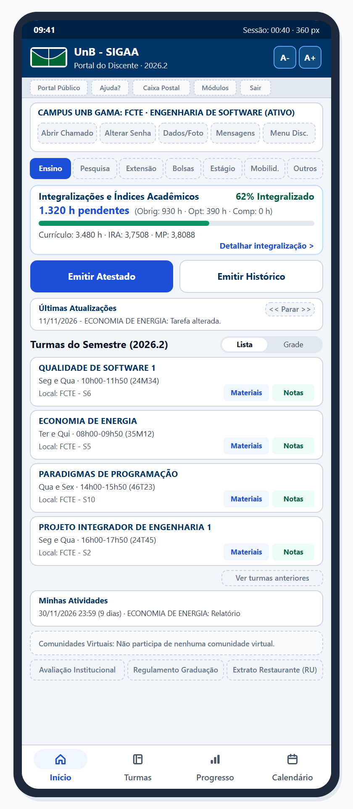
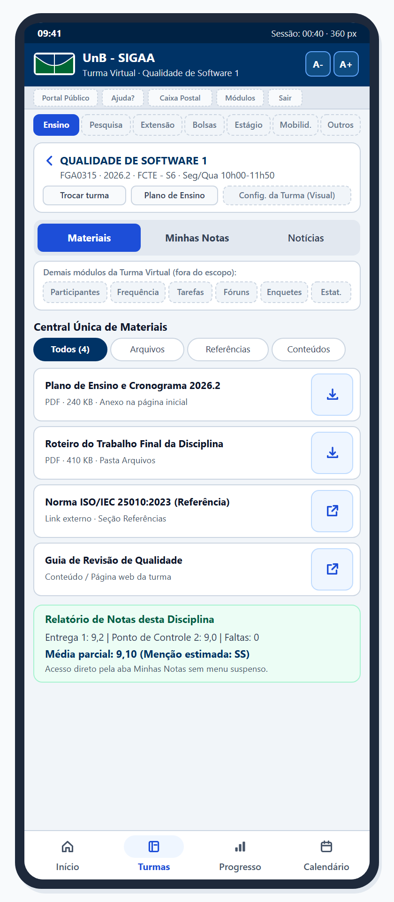
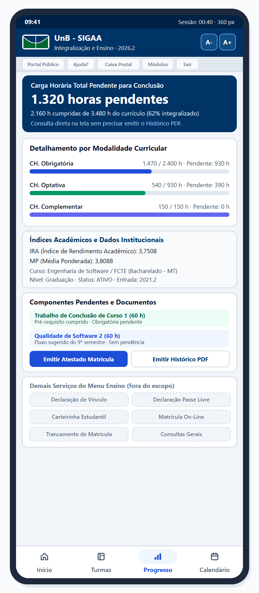
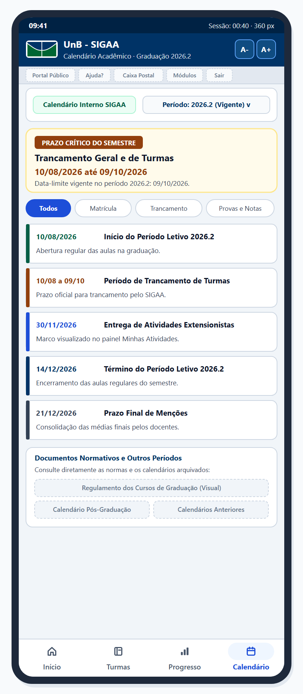

# Ação de Melhoria Técnica: Protótipo Mobile-First de Alta Fidelidade

<!-- Critério F4-C4: Coerência dos resultados com o propósito e atendimento às decisões da Fase 1. -->
<!-- Critério F4-C5: O julgamento final é rigoroso e traduzido em ação de melhoria concreta e justificada (Seção 3.2 do roteiro). -->

Conforme a seção 3.2 do roteiro da disciplina e o planejamento de [Cronograma da Entrega 2](../fase-3/cronograma.md#4-acao-de-melhoria-obrigatoria-criterio-de-selecao), a equipe executou obrigatoriamente uma **ação de melhoria técnica justificada pelas evidências da Fase 4**. O produto entregue é o **Protótipo Mobile-First de Alta Fidelidade do Portal do Discente do SIGAA/UnB (360 × 800 px)**, com identidade visual institucional da UnB, reorganização dos fluxos das tarefas **T1 a T6** e preservação visual dos demais controles presentes no sistema original.

---

## 1. Seleção da Oportunidade Crítica e Justificativa pelos Dados

O roteiro da disciplina prevê quatro modalidades possíveis de melhoria (protótipo de alta fidelidade, modificação de código, *templates* técnicos ou proposição de processo). A equipe descartou alterações diretas nos servidores do SIGAA por tratar-se de produto de código fechado sob gestão da STI/UnB ([Software Avaliado](../fase-1/software-avaliado.md#2-tipo-de-produto)) e selecionou o **desenvolvimento de um protótipo de alta fidelidade** porque os piores resultados da Fase 4 convergem em **interface, adaptabilidade móvel, acessibilidade e fluxo de navegação**:

1. **Falha total em telas pequenas e ao toque ([Flexibilidade](flexibilidade.md)):** **M14 = 0/12 (0%, Insatisfatório)**. Nenhuma das seis páginas declara `<meta name="viewport">`, forçando o navegador móvel a renderizar um *layout* fixo de `980 px` reduzido à escala `0,37` em `360 px` e `0,78` em `768 px`. Todos os `1.063` textos visíveis ficam abaixo de `12 px` efetivos (entre `2,9 px` e `3,8 px` no celular), nenhum controle atende à área mínima de `24 × 24 px` da WCAG 2.2 (o item *Ensino* mede `22,8 × 8,8 px`), e a Turma Virtual (T5) apresenta sobreposição de botões sobre o título da disciplina.
2. **Impacto real declarado pelos estudantes ([Teste com Usuários](teste-usuarios.md)):** no indicador **IQ4**, **5 de 5 participantes (100%)** utilizam o SIGAA no celular; **100%** relataram necessidade de *zoom* e rolagem horizontal (`zoom_rolagem`) e botões pequenos demais (`botoes_pequenos`); **40% (P2 e P3)** relataram menu que não abriu ao tocar (`menu_nao_abriu`); **40% (P1 e P2)** deixaram de concluir tarefas no aparelho (`nao_concluiu`); e **20% (P3)** dependem exclusivamente do celular.
3. **Insatisfação geral e ineficiência de navegação (G2 — Capacidade de Interação):** **M12 (SUS) = 32,5 (Insatisfatório)**, com todas as notas individuais (entre `17,5` de P3 e `45,0` de P4) abaixo do piso Regular (`51,0`), além de **M6 = 4,39× (Insatisfatório)**, **M4 = 73,3% (Regular)**, **M7 = 1,46× (Regular)** e **M11 = 53,3% (Regular)**.
4. **Barreiras automáticas de acessibilidade ([Acessibilidade](acessibilidade.md)):** **M9 = 13,17 erros/página (Insatisfatório, 79 erros em 6 páginas)**, concentrados em T5 (`37` erros) e T2 (`22` erros), com ausência de declaração de idioma (`language_missing`), `47` imagens sem texto alternativo (`alt_missing`), `11` botões vazios (`button_empty`) e `3` falhas de contraste (`contrast`).
5. **Dependência de ferramentas externas (G1 — Adequação Funcional):** **M3 = 60,0% (Insatisfatório)** — **3 de 5 participantes** (P2, P3 e P4) usam *No Fluxo UnB* ou planilhas próprias porque o sistema dificulta a leitura da grade horária e da integralização curricular.

A Tabela 1 estabelece a rastreabilidade direta entre cada evidência empírica coletada na Fase 4 e os dez requisitos de redesenho (`RM-01` a `RM-10`) incorporados ao protótipo.

*Tabela 1 - Rastreabilidade entre evidências da Fase 4 e requisitos do protótipo mobile.*

| ID | Requisito do Protótipo | Métrica / Evidência de Origem | Diagnóstico Empírico na Fase 4 | Solução Técnica Aplicada |
| :-: | :--- | :--- | :--- | :--- |
| `RM-01` | *Reflow* vertical e *viewport* nativa | **M14** (`0/12`), **IQ4** (`5/5` zoom/rolagem), `OP-03` | *Layout* de `980 px` reduzido a `0,37` em `360 px`; texto de `2,9–3,8 px`; botões cobrem título da turma em T5 (critério c) | Declaração `<meta name="viewport" content="width=device-width,initial-scale=1">`, empilhamento em coluna única (`360 px`), cabeçalhos com quebra de linha livre e fontes de `12 px` a `21 px` |
| `RM-02` | Integralização em `C_min = 0` cliques | **M4** (`20%` em T4), **M5** (`60%` em T4), **M6** (`8,48×` em T4), **M7** (`5,67` cliques em T4) | Painel *Integralizações* passa despercebido no canto direito; P2 levou `129 s` (`14` cliques) para chegar ao Histórico; P1 e P4 desistiram | Cartão destacado no topo da tela inicial exibindo **`1.320 h pendentes`** (`930 h` obrigatórias + `390 h` optativas de `3.480 h`, `62%` integralizado) e acesso em 1 toque ao detalhamento |
| `RM-03` | Decodificação *inline* de horários e salas | **M11** (`40%` em T2), **IQ2** (`40%` pediu ajuda em T2), `OP-01` | P3 e P6 consultaram a legenda `?`; P1 entrou por engano na Turma Virtual (`5` cliques); P2 e P4 abriram o Atestado | Exibição direta por extenso (*"Seg e Qua · 10h00–11h50"*) e local explícito (*"FCTE - S6"*) junto ao código técnico (`24M34`) |
| `RM-04` | Navegação por toque + fim da armadilha T6 | **M4** (`40%` em T6), **M5** (`60%` em T6), **M8** (`50%` em T6), **IQ1** (`2,0` em T6), **IQ4** (`2/5` menu falhou) | Menu *Ensino* (`22,8 × 8,8 px`) exigia *hover*; **3 de 5 (P3, P4, P6)** clicaram no link externo da SAA (Pós-Graduação) em T6 | Barra inferior fixa com 4 abas (`52–54 px`), botões de ação direta (`46–48 px`) e remoção do link externo da SAA em favor do calendário interno de `2026.2` |
| `RM-05` | Central única de materiais (T5) | **Sessões** (`P2`: `21` cliques, `8` erros em T5), `caminhos.csv` (`C1`–`C4`) | Materiais espalhados em 4 rotas distintas da Turma Virtual; retorno pelo navegador causou erro `Document Expired` | Abas segmentadas (*Materiais*, *Minhas Notas*, *Notícias*) com chips de filtro (*Todos*, *Arquivos*, *Referências*, *Conteúdos*) em uma só lista |
| `RM-06` | Autodescritividade e glossário de siglas | **M11** (`53,3%`), **IQ3** (`D2`), `OP-01` | Termos institucionais abreviados (IRA, MP) e prazos diluídos em tabelas longas reduzem compreensão sem legenda | Siglas expandidas no contexto (*"IRA — Índice de Rendimento Acadêmico"*) e banner superior com a data-limite de trancamento (`09/10/2026`) |
| `RM-07` | Conformidade WCAG 2.2 níveis A e AA | **M9** (`13,17` erros/pág.; `79` erros: `37` em T5 e `22` em T2) | Falta de `lang="pt-BR"` (`6`), imagens sem `alt` (`47`), botões/links vazios (`14`), campos sem rótulo (`3`) e contraste AA (`3`) | Atributo `lang="pt-BR"`, logo da UnB com texto alternativo explícito, `aria-label` descritivo em todo controle e contraste ≥ `4,5:1` (`#0F172A`/`#003366` sobre `#FFFFFF`) |
| `RM-08` | Grade semanal e simulador de fluxo | **M3** (`60%`), `OP-07` | P2, P3 e P4 usam *No Fluxo UnB* ou planilha pela dificuldade e baixa clareza do SIGAA | Alternador *Lista / Grade* na tela inicial e listagem de componentes obrigatórios pendentes com status de pré-requisitos na aba *Progresso* |
| `RM-09` | Orçamento de rede 4G e `CLS = 0` | [Desempenho](desempenho.md) (dados complementares de desempenho, sem nível nem questão associada: `T5` com `131` req., `1.955 KB`, `19,04 s` no 4G e `CLS = 1,053`; `T6` com `10,13 s`) | Turma Virtual desloca painéis após carregamento (`CLS = 1,053`); lista histórica de calendários consome metade do tempo de T6 | Carregamento sob demanda por aba sem recarregar bibliotecas globais e abertura direta no calendário vigente `2026.2` |
| `RM-10` | Preservação de `A+/A-` e funções fora do escopo | `OP-08` e [Escopo](../fase-1/escopo.md) | Controles `A+ / A-` já apoiam leitores com baixa visão; o portal real reúne dezenas de atalhos além de T1–T6 | Controles `A- / A+` preservados no cabeçalho mobile ao lado da logo da UnB, e manutenção visual (estado desabilitado/não clicável) de todas as funções fora do escopo |

*Fonte: elaboração da equipe, consolidando dados de [`dados/consolidados/metricas.csv`](https://github.com/FCTE-Qualidade-de-Software-1/2026-2_T02_ADELE_GOLDSTINE/blob/main/dados/consolidados/metricas.csv) e [`dados/consolidados/desempenho.csv`](https://github.com/FCTE-Qualidade-de-Software-1/2026-2_T02_ADELE_GOLDSTINE/blob/main/dados/consolidados/desempenho.csv).*

---

## 2. Arquitetura Mobile-First e Fidelidade ao Portal Real

A principal ruptura estrutural do protótipo é substituir os **menus suspensos horizontais por passagem do mouse** (`OP-02` e `OP-04`) e as **tabelas rígidas de `980 px`** por um fluxo vertical de `360 px` com **quatro abas primárias na barra inferior** (*Início*, *Turmas*, *Progresso* e *Calendário*).

Para preservar a fidelidade visual ao Portal do Discente real do SIGAA/UnB sem ampliar o escopo avaliado na Fase 1, todas as funções existentes no sistema original que não compõem as tarefas T1 a T6 foram **mantidas visualmente em estado não clicável** (identificadas graficamente por borda tracejada suave):

- **Cabeçalho e barra utilitária (`RM-10`):** emblema oficial da **Universidade de Brasília (UnB)**, título `UnB - SIGAA`, contador `Sessão: 00:40`, botões ativos `A- / A+` e atalhos visuais não clicáveis `Portal Público`, `Ajuda?`, `Caixa Postal`, `Módulos`, `Sair`, `Abrir Chamado`, `Alterar Senha`, `Dados e Foto`, `Mensagens` e `Menu Disc.`.
- **Faixa de módulos e rodapé:** `Ensino` destacado como módulo ativo ao lado de `Pesquisa`, `Extensão`, `Bolsas`, `Estágio`, `Mobilidade` e `Outros` (visuais), além dos painéis `Últimas Atualizações` (`<< Parar >>`), `Minhas Atividades`, `Comunidades Virtuais`, `Ver turmas anteriores`, `Avaliação Institucional`, `Regulamento Graduação` e `Extrato Restaurante (RU)`.
- **Submódulos secundários de Turma Virtual e Menu Ensino:** na Tela 2, permanecem visíveis de modo não clicável `Participantes`, `Frequência`, `Tarefas`, `Fóruns`, `Enquetes`, `Estatísticas` e `Config. da Turma`; na Tela 3, constam `Declaração de Vínculo`, `Passe Livre`, `Carteirinha Estudantil`, `Matrícula On-Line`, `Trancamento de Matrícula` e `Consultas Gerais`.

### 2.1 Diretrizes Técnicas de Interface e Desempenho

- **Escala e *Reflow* (`RM-01`):** base fluida de `360 px` a `768 px` sem largura fixa; conteúdo em coluna única, eliminando rolagem horizontal (WCAG 2.2 critério 1.4.10) e redução automática de *viewport* (`visualViewport.scale = 1,0`).
- **Tipografia e Ergonomia de Toque (`RM-04`):** corpo padrão de `13,5–14 px` (ajustável via `A-/A+`), acima do piso de `12 px` de M14; botões primários e barra inferior com `46–54 px` de altura, superando o mínimo de `24 × 24 px` da WCAG 2.5.8 e os `8,8 px` do menu *Ensino* atual.
- **Acessibilidade Semântica (`RM-07`):** documento raiz com `lang="pt-BR"`, `alt` explícito na logo da UnB, rótulos `aria-label` em todos os botões de ação e contraste superior a `12:1` no cabeçalho (`#FFFFFF` sobre `#003366`) e no corpo (`#0F172A` sobre `#FFFFFF`).

---

## 3. Protótipo Interativo Navegável (T1 a T6)

O simulador abaixo permite navegar ao vivo entre as quatro telas do protótipo, alternar entre **Lista** e **Grade**, inspecionar **Materiais** e **Minhas Notas**, testar os controles **`A-` / `A+`** e alterar o semestre no **Calendário Acadêmico**. Os botões em tracejado representam as funções originais do SIGAA mantidas apenas para fidelidade visual (`disabled`). Também é possível abri-lo em tela isolada em [`prototipo-interativo.html`](../assets/prototipo-mobile/prototipo-interativo.html).

[[PROTOTIPO_MOBILE_INTERATIVO]]

---

## 4. Detalhamento das Telas e Resolução dos Gargalos por Tarefa

### 4.1 Tela 1 — Início do Portal: Horários Decodificados, Documentos e Integralização (T2, T3 e T4)

Na avaliação atual, o Portal do Discente concentra o estudante nos códigos `24M34` / `35T45` da tabela inicial (**T2**, **M11 = `40%`**), obriga a abrir o menu *Ensino* em cascata para emitir documentos (**T3**) e relega as *Integralizações* à coluna direita inferior (**T4**, **M4 = `20%`**, **M6 = `8,48×`**). A Tela 1 (Figura 1) traz essas funções para o fluxo principal em `360 px`, preservando a barra de módulos, `Últimas Atualizações`, `Minhas Atividades`, `Comunidades Virtuais` e os atalhos institucionais visuais do portal.



*Figura 1 - Tela 1 (Início do Portal Mobile): integralização em 0 cliques (`RM-02`), emissão direta de documentos (`RM-04`), horários decodificados (`RM-03`), grade semanal (`RM-08`) e atalhos institucionais visuais (`RM-10`).*

*Fonte: elaboração da equipe.*

*Tabela 2 - Requisitos aplicados na Tela 1 e impacto sobre T2, T3 e T4.*

| Requisito | Componente da Tela 1 | Diagnóstico na Fase 4 | Solução Aplicada |
| :---: | :--- | :--- | :--- |
| `RM-02` | Card *Integralizações e Índices* | **M4 = 20%** (`1/5`) e **M6 = 8,48×** em T4; P2 levou `129 s` (`14` cliques) e P1/P4 desistiram | Exibe **`1.320 h pendentes`** (`930 h` obrig. + `390 h` opt. de `3.480 h`, `62%` integralizado) e `IRA`/`MP` logo abaixo do cabeçalho |
| `RM-04` | Botões *Emitir Atestado* / *Histórico* | **IQ4 = 100%** com botões pequenos; **40%** relataram falha ao abrir menu no celular | Ações de toque direto (`38–46 px`) eliminam o menu suspenso de ~20 itens para gerar T3 em `1` toque |
| `RM-03` | Cartões *Turmas do Semestre (2026.2)* | **M11 = 40%** em T2 (P3 e P6 usaram legenda `?`); P1 entrou na Turma Virtual por engano | Mostra horário por extenso (*"Seg e Qua · 10h00–11h50"*) e local explícito (*"FCTE - S6"*) mantendo o código (`24M34`) como apoio |
| `RM-08` | Alternador *Lista / Grade* | **M3 = 60%** (`3/5` usam *No Fluxo UnB* ou planilha própria por falta de clareza horária) | Visualização semanal integrada das turmas matriculadas sem sair do portal |
| `RM-10` | Módulos, *Atualizações*, *Atividades* e rodapé | Portal real contém funções fora do escopo avaliado na Fase 1 | Mantém todos os blocos e atalhos do portal real em estado visual não clicável, preservando o mapa mental do usuário |

*Fonte: elaboração da equipe.*

---

### 4.2 Tela 2 — Turma Virtual Unificada e Minhas Notas (T1 e T5)

A Turma Virtual foi a tela mais crítica nas coletas técnicas: **única reprovada no critério (c) de M14** (botões cobriam o título `"...REDES DE COMPUTAD"` em `360 px` e `768 px`), **37 dos 79 erros automáticos do WAVE em M9** (`46,8%` da amostra), além de apresentar, nos dados complementares de [Desempenho](desempenho.md) (fora do julgamento GQM), maior peso em 4G (`131` requisições, `1.955 KB`, `19,04 s`) e `CLS = 1,053`. Além disso, `caminhos.csv` registrou **4 rotas distintas** para materiais (`C1` anexos, `C2` Arquivos, `C3` Referências, `C4` Conteúdos), cenário em que P2 acumulou `21` cliques, `8` erros e falha `Document Expired` ao usar o botão Voltar.

A Tela 2 (Figura 2) aplica os requisitos **`RM-01`**, **`RM-05`**, **`RM-07`**, **`RM-09`** e **`RM-10`**: separa o título integral da disciplina dos botões secundários, reúne os 4 locais de materiais em uma central única filtrável, posiciona **Minhas Notas (T1)** em uma aba direta ao lado de **Materiais (T5)** e mantém visíveis, de modo não clicável, os demais submódulos da Turma Virtual (`Participantes`, `Frequência`, `Tarefas`, `Fóruns`, `Enquetes` e `Estatísticas`).



*Figura 2 - Tela 2 (Turma Virtual Unificada e Notas): fim da sobreposição no cabeçalho (`RM-01`), central única das 4 origens de materiais (`RM-05`), acesso direto a Notas (`T1`), endereçamento dos 37 erros do WAVE (`RM-07`) e manutenção visual dos módulos secundários (`RM-10`).*

*Fonte: elaboração da equipe.*

---

### 4.3 Tela 3 — Integralização Curricular e Serviços de Ensino (T4 e M3)

No teste com usuários, **T4 apresentou os piores indicadores comportamentais**: apenas **20% na primeira escolha (M4)**, **60% de conclusão (M5)**, **8,48× o tempo do especialista (M6: `57,7 s` vs. `6,8 s`)** e **5,67 cliques médios** para `C_min = 0`, além de **40%** que já pediram ajuda (IQ2). A Tela 3 (Figura 3) implementa **`RM-02`**, **`RM-06`**, **`RM-07`**, **`RM-08`** e **`RM-10`**: coloca em destaque **`1.320 horas pendentes`** (`930 h` obrigatórias + `390 h` optativas + `0 h` complementares de `3.480 h`), traduz as siglas `IRA` e `MP` por extenso, exibe os componentes obrigatórios pendentes com status de pré-requisitos e mantém listados de forma visual (não clicável) os demais serviços do menu *Ensino* fora do escopo (*Declaração de Vínculo*, *Passe Livre*, *Carteirinha Estudantil*, *Matrícula On-Line*, *Trancamento de Matrícula* e *Consultas Gerais*).



*Figura 3 - Tela 3 (Integralização e Ensino): horas pendentes explícitas (`RM-02`), siglas traduzidas (`RM-06`), componentes pendentes para fluxo (`RM-08`), endereçamento dos 11 erros de acessibilidade de T4 (`RM-07`) e serviços visuais do menu Ensino (`RM-10`).*

*Fonte: elaboração da equipe.*

---

### 4.4 Tela 4 — Calendário Acadêmico Integrado (T6)

A consulta ao calendário (**T6**) recebeu a **pior facilidade percebida no questionário (`IQ1 = 2,0`)**, **40% de pedido prévio de ajuda (IQ2)**, **M4 = 40%**, **M5 = 60%**, **M6 = 4,67×** e **M8 = 50%**. Dos cinco participantes, **três (P3, P4 e P6)** clicaram primeiro no link *"Calendário Acadêmico de Graduação"* do painel inicial, sendo redirecionados à página de **Pós-Graduação** do site externo da SAA/UnB; além disso, a página intermediária listando todos os calendários desde o ano 2000 induziu P6 a abrir `2027.1` por engano e consome cerca de metade do tempo de carregamento da tarefa no 4G (`35` requisições). A Tela 4 (Figura 4) aplica **`RM-04`**, **`RM-06`**, **`RM-07`**, **`RM-09`** e **`RM-10`**, abrindo diretamente no semestre corrente (`2026.2`) dentro do próprio SIGAA com o prazo de **Trancamento (`10/08/2026 a 09/10/2026`)** destacado no topo.



*Figura 4 - Tela 4 (Calendário Acadêmico 2026.2 Integrado): eliminação do redirecionamento ao site da SAA (`RM-04`), abertura direta no período vigente sem a lista desde 2000 (`RM-09`), destaque de prazos com contraste AA (`RM-06` / `RM-07`) e links normativos visuais (`RM-10`).*

*Fonte: elaboração da equipe.*

---

## 5. Verificação de Conformidade Pós-Melhoria e Impacto Esperado nas Métricas

A Tabela 3 confronta o protótipo com os cinco critérios da ficha de **M14** e as oito regras do WAVE que falharam em **M9**. Em 23/11/2026, **M14 foi medida no protótipo** com os mesmos critérios usados no SIGAA: o *script* [`coleta/verificar_prototipo.py`](https://github.com/FCTE-Qualidade-de-Software-1/2026-2_T02_ADELE_GOLDSTINE/blob/main/coleta/verificar_prototipo.py) reaproveita a verificação de página (`JS_ADAPTACAO`) e os perfis de aparelho de `sigaa_coleta.py` e a função `criterios()` de `calcular.py`, no Google Chrome com emulação de 360 px e 768 px e toque, levando o protótipo ao estado final de cada tarefa por toques. O protótipo é medido em modo tela cheia: sem o guia lateral, a moldura e a barra de status simulada do celular, com a página inteira rolando e a barra de abas fixa no rodapé, como numa página web de celular (o detector trata camadas fixas como no SIGAA). Os dados estão em `dados/brutos/flexibilidade/automatizado/telas-prototipo.jsonl`, as capturas em `dados/brutos/flexibilidade/evidencias/prototipo/` e o resumo em `dados/consolidados/verificacao-prototipo.csv`.

A primeira medição deu **0 de 12**: o critério (b) falhou em todas as páginas, com textos de 9,5 a 11,5 px (rótulos, *chips* e botões fora do escopo), e o critério (e) falhou em 768 px nos botões tracejados de 22 px de altura. O protótipo foi ajustado (`coleta/prototipo_mobile.py`: tamanho mínimo de fonte de 12 px no simulador e altura mínima de 24 px nos botões fora do escopo) e medido de novo: **M14 = 12 de 12 (Excelente)**. M9 continua projetada, porque o motor da extensão WAVE (`wave.min.js`) não estava disponível na máquina da medição.

*Tabela 3 - Confronto técnico do protótipo contra as fichas de M14 e M9.*

| Métrica / Critério | Estado Atual Medido (`v4.15.10.116`) | Estado no Protótipo | Resultado no Protótipo |
| :--- | :--- | :--- | :--- |
| **M14 (a)** Sem rolagem horizontal / escala 1,0 | `0/12`: largura de *layout* `980 px`, escala `0,37` (360 px) e `0,78` (768 px) | `<meta viewport>` fixa largura no dispositivo (`360 px = 360 px`, escala `1,0`) | **Medido: 12/12** |
| **M14 (b)** Fontes efetivas `≥ 12 px` | `0/12`: `1.063/1.063` textos abaixo de `12 px` (`2,9` a `3,8 px` em 360 px) | Corpo padrão `13,5–14 px` e nenhum texto abaixo de `12 px` após o ajuste (antes: mínimo de `9,5 px`) | **Medido: 12/12** (0/12 antes do ajuste) |
| **M14 (c)** Sem texto sobreposto ou cortado | `10/12`: falha em T5 em `360 px` (3 textos) e `768 px` (4 textos) | Cabeçalho da Turma Virtual em fluxo vertical sem botões flutuantes sobre texto | **Medido: 12/12** |
| **M14 (d)** Menus acionáveis por toque | `12/12` em emulação, mas `40%` (`P2` e `P3`) relataram no questionário menu que não abriu ao tocar | Menus *hover* substituídos por barra inferior fixa e ações diretas | **Medido: 12/12** (todos os toques abriram a tela esperada) |
| **M14 (e)** Alvos de toque `≥ 24 × 24 px` | `0/12`: item *Ensino* com `22,8 × 8,8 px`; botões de tabela de `4–19 px` | Controles de ação com `44 × 44 px` a `52 px` de altura; botões fora do escopo com altura mínima de `24 px` após o ajuste | **Medido: 12/12** (10/12 antes do ajuste) |
| **M9** Erros automáticos WAVE (WCAG A/AA) | `13,17 erros/pág.` (`79` erros: `alt_missing`, `button_empty`, `language_missing`, `contrast`, `th_empty`, `label_missing`, `link_empty`) | HTML5 com `lang="pt-BR"`, `alt` explícito na logo UnB, botões com `aria-label` + texto, ausência de tabelas de *layout* e contraste > `4,5:1` | **0 erros estruturais (projetado; sem medição)** |

*Fonte: elaboração da equipe, a partir das fichas de [`docs/fase-2/metricas.md`](../fase-2/metricas.md), de `docs/fase-4/` e de `dados/consolidados/verificacao-prototipo.csv`.*

A Tabela 4 sintetiza a redução projetada do caminho mínimo (`C_min`) e das falhas observadas nas seis tarefas do escopo (**T1 a T6**).

*Tabela 4 - Impacto projetado do protótipo por tarefa do escopo (T1 a T6).*

| Tarefa | Caminho Mínimo Atual (`caminhos.csv`) e Gargalo Medido | Fluxo no Protótipo Mobile | Métricas Diretamente Beneficiadas |
| :-: | :--- | :--- | :--- |
| **T1 (Notas)** | `1` passo via menu *Ensino* (`M6 = 4,50×`; P1 entrou pela Turma Virtual em `3` cliques) | `1` toque a partir do cartão da turma na Tela 1 ou na aba *Minhas Notas* da Tela 2 | **M6**, **M7** |
| **T2 (Horários e local)** | `0` cliques na tabela inicial, mas código críptico gerou `M11 = 40%` e desvios | `0` cliques na Tela 1 com horário traduzido e sala explícita; opção de *Grade* | **M11**, **M3**, **M4**, **M7** |
| **T3 (Atestado)** | `1` clique dentro do menu *Ensino* (`22,8 × 8,8 px` no celular) | `1` toque direto no botão primário *Emitir Atestado* na Tela 1 | **M4**, **M6**, **M14 (e)** |
| **T4 (Integralização)** | `0` cliques nominais, mas média real de `5,67` cliques, `M4 = 20%`, `M5 = 60%`, `M6 = 8,48×` | `0` cliques no topo da Tela 1 (`1.320 h pendentes`) + `1` toque para detalhe na Tela 3 | **M4**, **M5**, **M6**, **M7**, **M11** |
| **T5 (Turma Virtual)** | `2–4` cliques em 4 submenus distintos; P2 fez `21` cliques, `8` erros; falha em `M14 (c)` e `37` erros no WAVE | Central única na Tela 2 com filtros por tipo e `0` sobreposições visuais | **M7**, **M8**, **M9**, **M14 (c)**; **CLS** (dado complementar de desempenho, fora do julgamento GQM) |
| **T6 (Calendário)** | `2` passos com link-armadilha para o site da SAA (`3/5` caíram) + lista desde 2000; `M4 = 40%`, `M5 = 60%`, `IQ1 = 2,0` | `1` toque na aba *Calendário* abre direto `2026.2` dentro do SIGAA com trancamento no topo | **M4**, **M5**, **M6**, **M7**, **M8**, **M11**, **IQ1** |

*Fonte: elaboração da equipe.*

---

## 6. Coerência com o Propósito da Avaliação e Recomendações (Critério F4-C4)

Este protótipo e os resultados da Fase 4 respondem diretamente às decisões planejadas na [Tabela 1 de Propósito e Partes Interessadas](../fase-1/proposito-stakeholders.md#13-como-os-resultados-serao-usados) e às necessidades das [Personas](../fase-1/personas.md):

1. **Para a STI/UnB (Priorização de telas e investimento mobile):** os dados indicam que o portal funciona de modo uniforme nos quatro navegadores de computador (**M13 = 100%, Excelente**), mas **falha integralmente em telas móveis (`M14 = 0/12`, Insatisfatório)**. Como **100%** dos participantes testados utilizam o sistema no celular (`IQ4`) e **3 de 5** têm o celular como dispositivo principal ou equivalente, recomenda-se priorizar: (i) remoção do link externo para a SAA em T6 e abertura direta no calendário vigente; (ii) tradução automática do código de horário na tabela inicial (`OP-01`); (iii) adoção gradual do layout responsivo de coluna única com `<meta viewport>` mantendo visualmente as demais funções do portal, e correção das 8 regras estruturais do WAVE em T5 e T2 (eliminando `74,7%` dos erros automáticos).
2. **Para o DEG e Coordenações de Curso:** recomenda-se padronizar avisos sobre prazos de trancamento diretamente no calendário do SIGAA e destacar o resumo de integralização curricular (`T4`), mitigando dúvidas presenciais e chamados em secretarias (Persona 4 — Carlos Eduardo) e atendendo à estudante usuária exclusiva de celular (Persona 1 — Mariana).
3. **Limitações desta entrega técnica:** o protótipo constitui especificação executável *client-side* em ambiente simulado; sua efetivação em produção depende da camada de apresentação JSF/RichFaces sob gestão da STI/UnB ou da UFRN, seguida de nova rodada de testes com usuários para mensurar o ganho efetivo de **SUS (M12)** e **M6**.

---

## 7. Como Reproduzir os Ativos Visuais do Protótipo

Os scripts de geração são versionados e determinísticos:

```bash
python coleta/prototipo_mobile.py        # gera os 4 SVGs e prototipo-interativo.html
python coleta/prototipo_mobile.py --png  # renderiza também os 4 PNGs 2x via Google Chrome headless
```

Os arquivos ficam em [`docs/assets/prototipo-mobile/`](https://github.com/FCTE-Qualidade-de-Software-1/2026-2_T02_ADELE_GOLDSTINE/tree/main/docs/assets/prototipo-mobile), e o gancho em [`mkdocs.yml`](https://github.com/FCTE-Qualidade-de-Software-1/2026-2_T02_ADELE_GOLDSTINE/blob/main/mkdocs.yml) injeta automaticamente a versão interativa nesta página durante o *build* do site.

---

## Referências

[1] ISO/IEC 25010:2023. *Systems and software engineering — Systems and software Quality Requirements and Evaluation (SQuaRE) — Product quality model*.

[2] ISO/IEC 25040:2024. *Systems and software engineering — Systems and software Quality Requirements and Evaluation (SQuaRE) — Quality evaluation framework*.

[3] W3C. *Web Content Accessibility Guidelines (WCAG) 2.2*. W3C Recommendation, 2023. Disponível em: <https://www.w3.org/TR/WCAG22/>.


## Histórico de Versão

| Versão | Data | Descrição | Autor |
| :----: | :--: | :-------: | :---: |
| 1.0 | 21/11/2026 | Elaboração do Protótipo Mobile-First de alta fidelidade (SVG, PNG e simulador interativo), matriz de rastreabilidade `RM-01` a `RM-10`, justificativa pelas métricas da Fase 4 e recomendações à STI/UnB e ao DEG | [Davi Nobre](https://github.com/Jagaima) |
| 1.1 | 21/11/2026 | Remoção da figura comparativa Antes/Depois e das caixas explicativas externas nas imagens, inclusão da logo da UnB na versão html e exibição visual de todas as funções do Portal do Discente fora do escopo | [Davi Nobre](https://github.com/Jagaima) |
| 1.2 | 22/11/2026 | Ajustes da revisão do PR: explicitação de resultados projetados em M14/M9 e dados complementares de desempenho em RM-09/T5, correção de redação em M14 (d) e seção 6, e padronização de legendas de tabelas e figuras | [Davi Nobre](https://github.com/Jagaima) |
| 1.3 | 23/11/2026 | Verificação medida de M14 no protótipo (0/12 na primeira medição, 12/12 após o ajuste de fontes e alvos), com o novo *script* `coleta/verificar_prototipo.py`; M9 segue projetada | Caio Borges |
